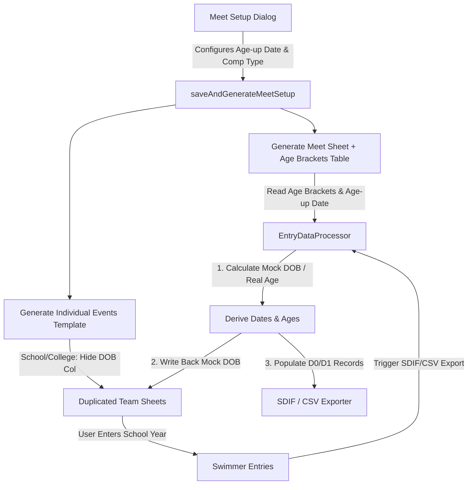

# Requirements

### Overview & Goals
In competitive swim management, an **Age-up Routine** determines an athlete's official competition age category based on a reference **Age-up Date**. For standard Age Group meets, athlete ages are calculated directly from their Date of Birth against this cutoff date and encoded into SDIF exports. For School and College meets where swimmers are registered by school year or division (e.g. Y5–Y8, Junior, Intermediate, Senior), an explicit Date of Birth is typically omitted for privacy reasons. However, meet management software like Hy-Tek Meet Manager still requires swimmer ages and dates of birth to classify entries properly.

This initiative introduces:
1. An official **Age-up calculation routine** for Age Group meets that computes athlete age as of the Age-up Date and exports it in SDIF D0 records (positions 64–65).
2. An editable **School Year Age Brackets proxy table** on the `Meet` sheet with default min/max age mappings (e.g., Y5: 9–9, Y6: 10–10, Y7: 11–11, Y8: 12–12; Junior: 13–13, Intermediate: 14–15, Senior: 16–18).
3. Automatic **Mock Date of Birth calculation** derived from the Age-up Date and assigned `Min Age` and `Max Age`, generating randomized day and month values for each swimmer within the bracket range, written back to the entry sheet's hidden `Date of Birth` column during export.
4. Programmatic **hiding of the `Date of Birth` column** in School and College entry templates to prevent manual entry and protect student privacy.
5. Unhidden **Age-up Date** date input in Meet Setup across all competition types, allowing users to enter/select the exact reference date directly.

### Scope
- **In Scope**:
  - Add schema and builder support for an editable `AgeBrackets` table placed on the `Meet` sheet.
  - Enable Age-up Date selection in `meet-setup-ui.html` for all relevant competition types.
  - Programmatically hide the `Date of Birth` column in `IndividualEventsTemplate` and duplicated sheets when competition type is `School` or `College`.
  - Implement age calculation logic for Age Group meets (`refDate - dob`) and encode athlete age in SDIF D0 record (positions 64–65).
  - Implement mock DOB derivation for School/College entries, writing computed dates back to the entry sheet cells and populating SDIF D0/D1 / CSV records.
  - SDIF record for School must have the year (e.g. Y5) or for College the accronym (Jr,In, Sr) in the SDIF D0 (positions 64-65). We only inject the date of birth, not age.
  - Add diagnostic tests covering age calculation, mock DOB derivation, table generation, and SDIF output.
- **Out of Scope**:
  - Modifying external Hy-Tek Meet Manager file formatting standards.
  - Multi-season persistent athlete databases (computations are sheet/meet specific).

### User Stories
- **As a meet organizer running an Age Group meet**, I want athlete ages to be accurately calculated as of the meet's Age-up Date so that swimmer entries are placed into the correct age categories in Hy-Tek Meet Manager.
- **As a school sports coordinator**, I want to enter swimmer names and school years without collecting sensitive birthdate records, knowing the system will automatically synthesize valid proxy birthdates for Meet Manager.
- **As a meet administrator**, I want an editable Age Brackets table on the `Meet` sheet so I can override default age-to-year mappings if regional regulations vary.

### Functional Requirements
- **FR-1**: The system shall generate an editable `School Year Age Brackets` table on the `Meet` sheet (starting below the core Meet Details table with enough clear space for the header formatting) containing columns `['School Year', 'Min Age', 'Max Age']` when School or College competition types are configured.
- **FR-2**: In `meet-setup-ui.html`, the Age-up Date input shall be visible and required for all competition types, allowing the user to select an exact date (matching Start Date and End Date behavior).
- **FR-3**: When generating `IndividualEventsTemplate` for `School` or `College` meets, the `Date of Birth` column shall be programmatically hidden to prevent manual data entry.
- **FR-4**: For Age Group meets, the system shall calculate integer swimmer age as of the Age-up Date (or Start Date fallback) and populate SDIF D0 record positions 64–65 with the 2-digit age.
- **FR-5**: For School and College meets, when exporting entries (SDIF or CSV), the system shall resolve each swimmer's school year against the `AgeBrackets` table (`Min Age` and `Max Age`), generate a randomized mock DOB within the bracket's eligible birthdate range as of the Age-up Date, write the mock DOB back to the sheet's `Date of Birth` column, and populate SDIF records.
- **FR-6**: The mock Date of Birth calculation shall generate random day and month values ensuring that:
  $$\text{MinAge} \le \text{calculateExactAge}(\text{mockDOB}, \text{AgeUpDate}) \le \text{MaxAge}$$
  Specifically, mock birthdates are uniformly chosen in the date range $[\text{AgeUpDate} - (\text{MaxAge}+1)\text{ years} + 1\text{ day},\, \text{AgeUpDate} - \text{MinAge}\text{ years}]$.

# Technical Design

### Current Implementation
- `tableConfig.js` defines `COMPETITION_TYPES` with `hasSchoolYear` and `hasAgeUpDate` flags.
- `meet-setup-ui.html` captures meet details and submits a payload to `saveAndGenerateMeetSetup(formData)`.
- `tableBuilder.js` creates the `Meet`, `Events`, `Schools`/`Teams`, and `IndividualEventsTemplate` sheets.
- `EntryDataProcessor.js` processes swimmer rows, detects columns, and normalizes school years, but currently skips DOB validation if empty or leaves it blank.
- `SDIFCreator.js` builds D0 and D1 records. D0 pos 64–65 currently outputs `pad_(swimmer.schoolYear || "", 2)` which remains blank for Age Group meets.

### Key Decisions
- **Decision 1: Place Editable Age Brackets Table (Min Age & Max Age) on Meet Sheet**
  - *Rationale*: Storing the table below Meet Details on the `Meet` sheet (`Meet!A4:C10` or similar clear offset) keeps all competition-level configuration consolidated in one place while allowing organizers to customize `Min Age` and `Max Age` ranges for specific tournaments without confusing `Default Age` columns.
- **Decision 2: Randomize Mock DOB within [Min Age, Max Age] on Age-up Date**
  - *Rationale*: Synthesizing distinct random days and months for each swimmer prevents all athletes from sharing an identical birthdate in Meet Manager while strictly guaranteeing their computed age on the Age-up Date satisfies `Min Age <= age <= Max Age`.
- **Decision 3: Compute and Write Back Mock DOBs to Sheet on Export**
  - *Rationale*: Writing back mock birthdates to the hidden `Date of Birth` column ensures the spreadsheet contains complete audit-ready records if inspected, while keeping user entry focused solely on School Year.
- **Decision 4: Programmatically Hide DOB Column in School & College Templates**
  - *Rationale*: Hiding the column preserves uniform column indexing across all competition types while preventing end users from entering private student birthdates. Duplicating the template sheet naturally preserves the hidden column state.
- **Decision 5: Encode Age in SDIF D0 Positions 64–65 for Age Group Meets**
  - *Rationale*: Meets the SDIF v3 specification where positions 64–65 carry the athlete's age in years (or school year for scholastic meets), allowing Meet Manager to seed events seamlessly.

### Architecture Diagram



### Data Models / Contracts

#### Default Age Brackets Mapping (`tableConfig.js`)
```javascript
const DEFAULT_AGE_BRACKETS = {
  school: [
    { schoolYear: 'Y5', minAge: 9, maxAge: 9 },
    { schoolYear: 'Y6', minAge: 10, maxAge: 10 },
    { schoolYear: 'Y7', minAge: 11, maxAge: 11 },
    { schoolYear: 'Y8', minAge: 12, maxAge: 12 }
  ],
  college: [
    { schoolYear: 'Junior', minAge: 13, maxAge: 13 },
    { schoolYear: 'Intermediate', minAge: 14, maxAge: 15 },
    { schoolYear: 'Senior', minAge: 16, maxAge: 18 }
  ]
};
```

#### Age & Randomized Mock DOB Calculation Logic (`utils.js` / `EntryDataProcessor.js`)
```javascript
function calculateExactAge(dobDate, refDate) {
  let age = refDate.getFullYear() - dobDate.getFullYear();
  const m = refDate.getMonth() - dobDate.getMonth();
  if (m < 0 || (m === 0 && refDate.getDate() < dobDate.getDate())) {
    age--;
  }
  return Math.max(0, age);
}

function generateMockDob(minAge, maxAge, ageUpDate) {
  // Earliest eligible DOB: day after (ageUpDate - (maxAge + 1) years)
  const minDate = new Date(
    ageUpDate.getFullYear() - (maxAge + 1),
    ageUpDate.getMonth(),
    ageUpDate.getDate() + 1
  );
  // Latest eligible DOB: ageUpDate - minAge years
  const maxDate = new Date(
    ageUpDate.getFullYear() - minAge,
    ageUpDate.getMonth(),
    ageUpDate.getDate()
  );
  const minTime = minDate.getTime();
  const maxTime = maxDate.getTime();
  const randomTime = minTime + Math.random() * (maxTime - minTime);
  const randomDate = new Date(randomTime);
  return new Date(randomDate.getFullYear(), randomDate.getMonth(), randomDate.getDate());
}
```

### Proposed Changes

#### 1. Schema & Table Configuration (`tableConfig.js`)
- Add `DEFAULT_AGE_BRACKETS` dictionary with `school` and `college` mappings using only `minAge` and `maxAge`.
- Add `AgeBrackets` table definition with columns `['School Year', 'Min Age', 'Max Age']` and integer numeric validation rules.
- Update `COMPETITION_TYPES` in `tableConfig.js` so `hasAgeUpDate: true` is enabled across all competition types.

#### 2. Table Builder & Template Hiding (`tableBuilder.js` & `duplicateTemplate.js`)
- In `saveAndGenerateMeetSetup`:
  - When `preset.hasSchoolYear` is true, generate the `AgeBrackets` table on the `Meet` sheet (below Meet Details) and populate default bracket rows.
  - When creating `IndividualEventsTemplate`, if `compType` is `school` or `college`, locate the `Date of Birth` column index and call `sheet.hideColumns(colIndex)`.

#### 3. Data Processing & Write-Back (`EntryDataProcessor.js` / `utils.js`)
- Read the `AgeBrackets` table from the `Meet` sheet (fallback to `DEFAULT_AGE_BRACKETS` if missing).
- In `processSwimmerEntries()` / `processEntryRow()`:
  - If `dob` is provided (Age Group): compute `swimmer.age = calculateExactAge(swimmer.dob, meetInfo.ageUpDate || meetInfo.startDate)`.
  - If `dob` is missing and `schoolYear` is present: match school year to bracket, calculate a randomized `mockDob = generateMockDob(bracket.minAge, bracket.maxAge, ageUpDate)`, set `swimmer.dob = mockDob`, and queue the cell update to write back to the sheet.
- Implement batch write-back helper `writeMockDobsToSheet_(sheet, updates)`.

#### 4. SDIF D0/D1 Record Formatting (`SDIFCreator.js`)
- In `emitD0_`:
  - Position 56–63: `pad_(dob, 8)` (uses real DOB or mock DOB).
  - Position 64–65: `pad_(swimmer.schoolYear || swimmer.age || "", 2)` (outputs school year if present, or 2-digit age for age-group meets).
- Ensure `buildMMNumber_` correctly hashes the mock DOB for school/college swimmers without collisions.

#### 5. Meet Setup Dialog (`meet-setup-ui.html`)
- Display the Age-up Date field (`<input type="date" id="ageUpDate">`) unconditionally for all competition types.
- Require users to select or enter the Age-up Date just like `startDate` and `endDate` without any contextual pre-population or magic defaults.

### File Structure
- `tableConfig.js`: Table schemas, `DEFAULT_AGE_BRACKETS`, and preset configurations.
- `tableBuilder.js`: Meet sheet age bracket table creation and template column hiding.
- `EntryDataProcessor.js`: Age calculation, mock DOB generation, and sheet write-back routine.
- `SDIFCreator.js`: SDIF D0/D1 record formatting with athlete age and mock DOB.
- `meet-setup-ui.html`: Meet Setup dialog date fields and competition type handlers.
- `tests.js`: Unit and diagnostic tests for age calculation and mock DOB routines.

# Testing

### Validation Approach
Verification will include headless unit tests in `tests.js` executing under Node.js runtime, as well as simulated sheet data transformations covering both Age Group exact age calculation and School/College mock DOB derivation and write-back.

### Key Scenarios
- **Scenario 1: Age Group Exact Age Calculation**
  - Swimmer with DOB `15/06/2012` and Age-up Date `01/10/2026` → Age is `14`.
  - Swimmer with DOB `15/10/2012` and Age-up Date `01/10/2026` → Age is `13`.
  - Verify SDIF D0 position 64–65 contains `"14"` and `"13"` respectively.
- **Scenario 2: School Mock DOB & Write-Back**
  - Swimmer entered with School Year `"Y6"` (`Min Age = 10, Max Age = 10`), empty DOB, Age-up Date `01/01/2026`.
  - Verified mock DOB has random month/day falling between `02/01/2015` and `31/12/2015`.
  - Calculated age on `01/01/2026` equals `10`.
  - Verify cell in `Date of Birth` column on entry sheet is updated with the generated mock DOB.
- **Scenario 3: College Mock DOB with Multi-Year Brackets and Overrides**
  - Intermediate swimmer (`Min Age = 14, Max Age = 15`) with Age-up Date `01/01/2026`.
  - Generated mock DOB falls between `02/01/2010` and `31/12/2011`.
  - Calculated age on `01/01/2026` is either 14 or 15.
  - Admin overrides Intermediate min/max age on Meet sheet → mock DOBs strictly adhere to new range.
- **Scenario 4: Template Column Visibility**
  - Generate School template → `Date of Birth` column exists in table structure but is hidden on the sheet.

### Test Changes
- Add `testAgeCalculationRoutine()` in `tests.js` testing exact age math across leap years and boundary dates.
- Add `testMockDobGeneration()` in `tests.js` validating that 100+ generated random mock birthdates always produce an exact age between `minAge` and `maxAge` on the Age-up Date.
- Add `testAgeBracketsTableSchema()` in `tests.js` asserting table definition columns (`School Year`, `Min Age`, `Max Age`) and placement.

# Delivery Steps

### ✓ Step 1: Configure Age Brackets schema and Meet sheet table builder
Define default school/college age brackets with `Min Age` and `Max Age` in `tableConfig.js` and generate the editable `AgeBrackets` table on the `Meet` sheet.

- Define `DEFAULT_AGE_BRACKETS` in `tableConfig.js` mapping School (Y5: 9–9, Y6: 10–10, Y7: 11–11, Y8: 12–12) and College (Junior: 13–13, Intermediate: 14–15, Senior: 16–18) using strictly `minAge` and `maxAge`.
- Add the `AgeBrackets` table schema to `tableConfig.js` with columns `['School Year', 'Min Age', 'Max Age']` and integer numeric validation rules.
- Update `saveAndGenerateMeetSetup()` in `tableBuilder.js` to create and populate the `AgeBrackets` table below Meet Details when competition types have school years (`School` and `College`).
- Add assertions in `tests.js` validating `AgeBrackets` table generation, column structure, and defaults.

### ✓ Step 2: Update Meet Setup UI with Age-up Date input and template column hiding
Enable the Age-up Date date input for all competition types in the setup dialog and hide the Date of Birth column for scholastic templates.

- Update `meet-setup-ui.html` so `Age-up Date` is visible and required for all competition types as a standard date picker (without contextual auto-population), allowing users to select any desired cutoff date just like Start Date and End Date.
- Update `tableBuilder.js` during `IndividualEventsTemplate` creation to programmatically hide the `Date of Birth` column via `sheet.hideColumns()` when competition type is `school` or `college`.
- Ensure sheet duplication in `duplicateTemplate.js` preserves the hidden state of the `Date of Birth` column.

### ✓ Step 3: Implement exact age calculation, randomized mock DOB generation, and sheet write-back
Implement core age calculation mathematics and randomized mock DOB derivation in `EntryDataProcessor.js` / `utils.js` with batch sheet updates.

- Implement `calculateExactAge(dob, refDate)` in `utils.js` to compute completed integer years between dates.
- Implement `generateMockDob(minAge, maxAge, ageUpDate)` in `utils.js` / `EntryDataProcessor.js` to derive random mock birthdates with varying days and months strictly constrained such that swimmer age on the Age-up Date falls within `[minAge, maxAge]`.
- Update `processSwimmerEntries()` and `processEntryRow()` in `EntryDataProcessor.js` to read the `AgeBrackets` table from the `Meet` sheet, generate randomized mock DOBs for empty DOB rows with school years, and batch write-back values to the entry sheet's `Date of Birth` column.
- Update `tests.js` with unit tests for `calculateExactAge` and statistical/boundary tests for `generateMockDob`.

### ✓ Step 4: Integrate Age and Mock DOB with SDIF D0/D1 records and CSV exports
Ensure SDIF D0/D1 and CSV outputs correctly output calculated athlete ages and mock birthdates.

- Update `emitD0_` in `SDIFCreator.js` to output calculated athlete age in positions 64–65 for Age Group meets (`pad_(swimmer.schoolYear || swimmer.age || "", 2)`).
- Ensure `buildMMNumber_` uses the mock DOB for school/college swimmers so valid 12-character Meet Manager IDs are created without collision.
- Run complete diagnostic test suite in `tests.js` covering SDIF record emission across all 5 competition types.