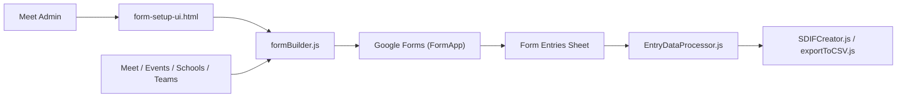

---
sessionId:
---

# Requirements

### Overview & Goals

Currently, Swim Entries Manager is designed around spreadsheet templates (`Individual Entries Template`) filled by team managers and sports coordinators on behalf of swimmers. However, for meets where **parents** (Intermediate / College) or **swimmers themselves** (Open / Masters) submit their own entries, a public-facing **Google Form** is needed.

This plan defines the design and implementation of a **Programmatic Entry Form Generator** inside the Swim Entries Manager add-on. Using `FormApp`, the add-on will generate (and later sync) a Google Form tailored to the active meet's `COMPETITION_TYPES` configuration, pre-populated with validated `Events`, `Schools`/`Teams`, and `School Year` options from the workbook, and linked directly to the spreadsheet so responses flow into the existing SDIF/CSV export pipeline.

### Scope

#### In Scope

- **OAuth Manifest (`appsscript.json`)**: Add the `https://www.googleapis.com/auth/forms` scope required by `FormApp`.
- **Entry Parser Compatibility (`EntryDataProcessor.js`)**: Update `detectColumnMapping()`, `detectColumnFormat()`, `detectEventTimeColumns()`, and `detectEventColumnsWithBestTime()` to handle Google Forms' prepended `Timestamp` and `Email Address` columns, plus duplicate-event selection checks per swimmer.
- **Form Generator & Sync Service (`formBuilder.js`)**: New server-side module to:
    - Validate that `Meet`, `Events`, and `Schools`/`Teams` exist and contain non-placeholder entries.
    - Generate a competition-type-aware Google Form (`FormApp.create`) linked to the active spreadsheet (`FormApp.DestinationType.SPREADSHEET`).
    - Persist Form metadata (`formId`, `publishedUrl`, `editUrl`, `destinationSheetName`) in `PropertiesService.getDocumentProperties()`.
    - Support updating/syncing dropdown options (`Events`, `Schools`/`Teams`) on the existing Form without creating duplicate Forms or response tabs.
- **Form Setup Dialog & Menu (`form-setup-ui.html`, `ui.js`)**: Add UI to configure form options (e.g., max event slots, email collection / response editing, optional DOB for School/College), generate/sync the Form, and display copyable Responder and Edit URLs.
- **Export Sheet Filtering (`SDIFCreator.js`)**: Ensure the linked Form response sheet is recognized as a valid candidate entry sheet in `getEntriesSheetNames_()`.
- **Unit Tests & Documentation (`tests.js`, `docs/SWIM_ENTRIES_MANAGER_SPEC.md`, `docs/USER_GUIDE.md`)**: Cover column-offset parsing, prerequisite validation, option extraction (stripping placeholders/formulas), and user documentation.

#### Out of Scope

- Building a custom web app outside Google Forms.
- Relay entry forms (this plan covers **individual entries** only).
- Automatic payment collection or meet fee calculation.

### User Stories

- **As a Meet Administrator**, I want to generate a Google Form directly from my configured Meet workbook, so that parents or individual swimmers can submit their own entries without editing the master spreadsheet.
- **As a Meet Administrator**, I want the Form's dropdowns (Events, Schools/Teams, School Years) to be populated from my existing core sheets and syncable if I add more later, so I don't have to maintain two separate lists.
- **As a Parent or Swimmer**, I want clear validation on seed times and dates of birth, plus the ability to edit my submission if I make a mistake, so my entries are accurate before the meet closes.
- **As a Meet Administrator**, I want Form responses to be directly exportable to SDIF (`.sd3`) and CSV using the existing export dialogs without manual column reformatting.

### Functional Requirements

- **FR-1 (Prerequisites Check)**: Before generating a Form, the system shall verify that `Meet`, `Events`, and the appropriate organization sheet (`Schools` or `Teams`) exist and contain at least one non-empty, non-placeholder entry (filtering out `"School Name"`, `"Team Name"`, `"Team / Club Name"`, and blank formula rows).
- **FR-2 (Competition-Type Adaptation)**:
    - For `hasSchoolYear: true` (`school`, `college`), include `School Year` (from `preset.schoolYears` / `AgeBrackets`) and `School` (from `Schools`), with `Date of Birth` configurable (optional or required per dialog setting).
    - For `hasSchoolYear: false` (`age_group`, `open`, `masters`), omit `School Year`, require `Date of Birth` (`DateItem`), and use `Team` (from `Teams`).
- **FR-3 (Event & Seed Time Slots)**: Generate `N` configurable `Event X` (dropdown of valid events) + `Time X` (short text with regex time validation `^(\d{1,2}:)?\d{1,2}\.\d{2}$|^NT$`) pairs matching `METHOD_1` in `EntryDataProcessor.js`.
- **FR-4 (Unattached / Write-in Teams)**: Provide a configurable option for Open/Masters meets to allow an unlisted/unattached team write-in (falling back to `"UNS"` in `getSchoolCode()` unless added to `Teams`).
- **FR-5 (Response Editing & Duplicate Prevention)**: Support enabling email collection (`form.setCollectEmail(true)`) and response editing (`form.setAllowResponseEdits(true)`), and detect/warn on duplicate event selections within a single swimmer row during `EntryDataProcessor.js` parsing.
- **FR-6 (Form Persistence & Sync)**: Store the Form ID in `PropertiesService.getDocumentProperties()` so subsequent runs update existing question choices (`Events`, `Schools`/`Teams`) in place rather than creating a new Form and `Form Responses 2` tab.
- **FR-7 (Parser Offset Compatibility)**: `EntryDataProcessor.js` shall accurately detect swimmer and event columns even when `Timestamp` and `Email Address` appear in Columns A and B.

### Non-Functional Requirements

- **OAuth & Marketplace**: Adding `https://www.googleapis.com/auth/forms` in `appsscript.json` requires user re-consent and Google Workspace Marketplace OAuth scope review before publishing.
- **Privacy**: When collecting minor PII (names, DOB, school) via a public Form URL, the generated Form description shall include a configurable privacy/consent notice, and `docs/` privacy documentation shall be updated.

# Technical Design

### Current Implementation

- `appsscript.json` declares `spreadsheets`, `spreadsheets.currentonly`, `drive.file`, `userinfo.email`, `userinfo.profile`, `script.container.ui`, and `script.locale`, but **omits** `https://www.googleapis.com/auth/forms`.
- `EntryDataProcessor.js`:
    - `detectColumnMapping(headerRow)` (line 108) only checks `headerRow[0]` for `#` / `No` (`hasNumberColumn`), and falls back to fixed offsets `0..5 + offset`.
    - `detectColumnFormat(headerRow)` (line 206), `detectEventTimeColumns(headerRow)` (line 261), and `detectEventColumnsWithBestTime(headerRow)` (line 323) hardcode their scan loop start at `col = 5` (Column F). With `Timestamp` (Col A) and `Email Address` (Col B) prepended by Google Forms, `School` shifts to Col G/H and `Event 1` shifts to Col H/I, causing column detection to misalign or skip columns.
- `SDIFCreator.js`:
    - `getEntriesSheetNames_(ss)` (line 1234) scans non-reserved sheets using `sheetHasSwimmerHeaders_(sheet)`, which will naturally detect Form response sheets once headers match, though naming the linked sheet clearly (e.g., `Form Entries`) improves UX.
- `tableConfig.js` defines `COMPETITION_TYPES` and placeholder defaults (`"School Name"`, `"Team Name"`, `"Team / Club Name"`) in `Schools`, `Teams`, and `EventsForTemplate` (15 formula rows).

### Key Decisions

- **Decision 1: Use `METHOD_1` (`Event 1` / `Time 1` … `Event N` / `Time N`) for Form Layout**
    - _Rationale_: Google Forms has no repeating-row grid widget. `METHOD_1` maps 1-to-1 to `detectEventTimeColumns` in `EntryDataProcessor.js` and keeps the Form compact (e.g., 4–6 configurable slots) compared to `METHOD_2` (which would require 2 questions per event in the meet).
- **Decision 2: Fix `EntryDataProcessor.js` Column Offsets Dynamically via `columnMapping.eventStartCol`**
    - _Rationale_: Instead of forcing Form responses through a separate staging converter, making `detectColumnMapping`, `detectColumnFormat`, `detectEventTimeColumns`, and `detectEventColumnsWithBestTime` respect `Timestamp` / `Email Address` and scan from `mapping.eventStartCol` allows the existing SDIF and CSV exporters to consume Form response sheets directly.
- **Decision 3: Persist Form ID in `PropertiesService.getDocumentProperties()` for In-Place Sync**
    - _Rationale_: Google Forms dropdowns are static snapshots. Persisting `formId` per spreadsheet enables a **Sync Form Options** workflow that updates `Events` and `Schools`/`Teams` choices in place without creating orphan Forms or `Form Responses 2` tabs.

### Proposed Changes

#### 1. `appsscript.json`

- Add `"https://www.googleapis.com/auth/forms"` to `oauthScopes`.

#### 2. `EntryDataProcessor.js`

- Update `detectColumnMapping(headerRow)` to recognize `timestamp` and `email address` as leading non-entry metadata columns so fallback column indices and `eventStartCol` are computed accurately.
- Update `detectColumnFormat(headerRow, startCol)`, `detectEventTimeColumns(headerRow, startCol)`, and `detectEventColumnsWithBestTime(headerRow, startCol)` to accept an optional `startCol` (defaulting to `mapping.eventStartCol` when available, or `5` for backward compatibility).
- Add duplicate-event detection within a single swimmer's `Event 1..N` selections so duplicate entries for the same event are flagged in exceptions or deduplicated cleanly.

#### 3. `formBuilder.js` _(new file)_

- Implement `validateFormPrerequisites_(ss)` to verify `Meet`, `Events`, and `Schools`/`Teams` exist and extract clean, deduplicated option lists (excluding empty strings, formula blanks, and placeholder defaults).
- Implement `createOrUpdateEntryForm(options)` using `FormApp`:
    - Create Form if no stored `formId` exists in `PropertiesService.getDocumentProperties()`, or open existing Form by ID.
    - Link destination to `ss.getId()` (`FormApp.DestinationType.SPREADSHEET`) and optionally rename the destination sheet to `Form Entries` if newly created.
    - Build/update questions based on `Meet` competition type (`First Name`, `Last Name`, `Date of Birth`, `Gender`, `School Year` if `hasSchoolYear`, `School`/`Team`, and `Event 1..N` + `Time 1..N` with regex validation).
    - Return `{ success, formId, publishedUrl, editUrl, destinationSheet, warnings }`.
- Implement `getStoredFormStatus()` to check whether a linked Form already exists for the current workbook.

#### 4. `form-setup-ui.html` & `ui.js`

- Create `form-setup-ui.html` using `shared-dialog-styles.html` with controls for:
    - Number of event slots (`1`–`9`, default `5`).
    - Toggle for **Collect Email & Allow Response Edits**.
    - Toggle for **Include Date of Birth** (when `hasSchoolYear: true`).
    - Toggle for **Allow write-in Team/Club ("Other")** (for Open/Masters).
    - Generate / Sync Form button and read-only copyable fields for Responder URL and Edit URL.
- Update `ui.js` to add **Create / Sync Entry Form** to the Add-on menu (`onOpen`) and sidebar (`buildAdminSidebarCard`), launching `showFormSetupDialog()`.

#### 5. `SDIFCreator.js`, `tests.js`, and `docs/`

- Verify `getEntriesSheetNames_(ss)` in `SDIFCreator.js` includes `Form Entries` / `Form Responses 1` when swimmer headers are present.
- Add unit tests in `tests.js` for `EntryDataProcessor.js` with `Timestamp` + `Email Address` leading columns, prerequisite validation, placeholder filtering, and duplicate event detection.
- Document the feature and new OAuth scope in `docs/SWIM_ENTRIES_MANAGER_SPEC.md` and `docs/USER_GUIDE.md`.

### Data Models / Contracts

```javascript
// Options passed from form-setup-ui.html to createOrUpdateEntryForm(options)
{
  eventSlots: number,          // 1..9 (default 5)
  collectEmailAndAllowEdits: boolean,
  requireDobForSchool: boolean,
  allowOtherTeam: boolean,
  formDescription: string
}

// Return payload from createOrUpdateEntryForm(options)
{
  success: boolean,
  isUpdate: boolean,
  formId: string,
  publishedUrl: string,
  editUrl: string,
  destinationSheet: string,
  eventCount: number,
  organizationCount: number
}
```

### File Structure

- `appsscript.json` _(modified)_: Add `forms` OAuth scope.
- `EntryDataProcessor.js` _(modified)_: Support leading `Timestamp`/`Email Address` columns and duplicate-event detection.
- `formBuilder.js` _(added)_: Prerequisite validation, `FormApp` generation/sync, and `PropertiesService` persistence.
- `form-setup-ui.html` _(added)_: Modal dialog for configuring, generating, syncing, and copying Form URLs.
- `ui.js` _(modified)_: Add menu item, sidebar card button, and `showFormSetupDialog()`.
- `tests.js` _(modified)_: Add unit tests for Form column-offset parsing and prerequisite/option extraction.
- `docs/SWIM_ENTRIES_MANAGER_SPEC.md` _(modified)_: Document programmatic Form workflow.
- `docs/USER_GUIDE.md` _(modified)_: Document parent/swimmer self-entry Form setup and syncing.

### Architecture Diagram



### Risks

- **OAuth Re-Verification**: Adding `https://www.googleapis.com/auth/forms` will prompt existing users to re-authorize and may require Google Workspace Marketplace OAuth review.
- **Manually Edited Form Questions**: If an admin manually reorders or deletes questions in Google Forms outside the add-on, in-place sync must match questions by title or stored item IDs (falling back safely if an item was removed).
- **Write-in Team Names**: Swimmers using an `"Other"` write-in team option will export with `"UNS"` unless the admin adds the team to `Teams` before running SDIF/CSV export.

# Testing

### Validation Approach

Automated unit tests in `tests.js` (via Node.js GAS sandbox) will verify `EntryDataProcessor.js` column-offset handling, prerequisite checks, placeholder filtering, and `FormApp` mocking. Live deployment testing via `clasp push` will verify end-to-end Form creation, submission, response editing, and SDIF/CSV export in Google Sheets.

### Key Scenarios

1. **Form Response Header Parsing (`Timestamp` + `Email Address`)**:
    - Header row `['Timestamp', 'Email Address', 'First Name', 'Last Name', 'Date of Birth', 'Gender', 'School Year', 'School', 'Event 1', 'Time 1', 'Event 2', 'Time 2']` maps `firstName=2`, `school=7`, `eventStartCol=8`, and `detectColumnFormat` returns `METHOD_1`.
2. **Prerequisite & Placeholder Filtering**:
    - Workbooks with only `"School Name"` or blank `=IF(...)` event rows fail prerequisite validation with an actionable error message.
    - Workbooks with real events and schools strip placeholders and populate clean dropdown lists.
3. **In-Place Form Sync**:
    - Running `createOrUpdateEntryForm` a second time when `formId` is stored in `PropertiesService` updates the existing Form's choices without creating a duplicate Form.

### Edge Cases

- Swimmer selects the same event in both `Event 1` and `Event 2` -> flagged/deduplicated without crashing SDIF export.
- Stored `formId` points to a trashed/deleted Form -> gracefully prompt or recreate and update stored `formId`.
- `Schools`/`Teams` list is empty when `Team Officials` is used -> clear message indicating which sheet must be populated first.

### Test Changes

- Add `testFormResponseColumnMapping()` and `testFormPrerequisiteExtraction()` to `tests.js` and register them in `runAllDiagnosticTests()`.

# Delivery Steps

### Step 1: Update `EntryDataProcessor.js` for Form Response Column Offsets

`EntryDataProcessor.js` accurately parses swimmer and event columns when `Timestamp` and `Email Address` are prepended by Google Forms.

- Update `detectColumnMapping(headerRow)` in `EntryDataProcessor.js` to account for leading `Timestamp` and `Email Address` columns.
- Update `detectColumnFormat`, `detectEventTimeColumns`, and `detectEventColumnsWithBestTime` to scan from `mapping.eventStartCol` rather than hardcoding `col = 5`.
- Add duplicate-event detection per swimmer row for `METHOD_1` event/time pairs.
- Add `testFormResponseColumnMapping()` in `tests.js` to verify `Timestamp` + `Email Address` offset handling.

### Step 2: Implement `formBuilder.js` and OAuth Scope in `appsscript.json`

The backend can validate workbook prerequisites, generate a competition-type-aware Google Form via `FormApp`, link it to the spreadsheet, and sync options in place.

- Add `"https://www.googleapis.com/auth/forms"` to `oauthScopes` in `appsscript.json`.
- Create `formBuilder.js` with `validateFormPrerequisites_(ss)` to extract clean `Events`, `Schools`/`Teams`, and `School Year` lists while rejecting placeholder-only sheets.
- Implement `createOrUpdateEntryForm(options)` and `getStoredFormStatus()` in `formBuilder.js` using `FormApp` and `PropertiesService.getDocumentProperties()`.
- Add `testFormPrerequisiteExtraction()` in `tests.js` covering placeholder filtering and `FormApp` mock creation/sync.

### Step 3: Build `form-setup-ui.html` and Wire Menu/Sidebar in `ui.js`

Meet administrators can launch a dialog to configure, generate, or sync the entry Form and copy its responder/edit URLs.

- Create `form-setup-ui.html` styled with `shared-dialog-styles.html` containing form configuration options, generate/sync actions, and URL copy fields.
- Add `showFormSetupDialog()` and register **Create / Sync Entry Form** in `onOpen()` and `buildAdminSidebarCard()` in `ui.js`.

### Step 4: Verify Export Integration and Update Documentation

Form response sheets appear in SDIF/CSV export dialogs, all diagnostic tests pass, and documentation reflects the new workflow.

- Verify `getEntriesSheetNames_(ss)` in `SDIFCreator.js` detects the linked Form response sheet.
- Run `runAllDiagnosticTests()` in `tests.js` to confirm all existing and new tests pass.
- Update `docs/SWIM_ENTRIES_MANAGER_SPEC.md` and `docs/USER_GUIDE.md` with the Google Form setup, sync, OAuth scope, and privacy details.
