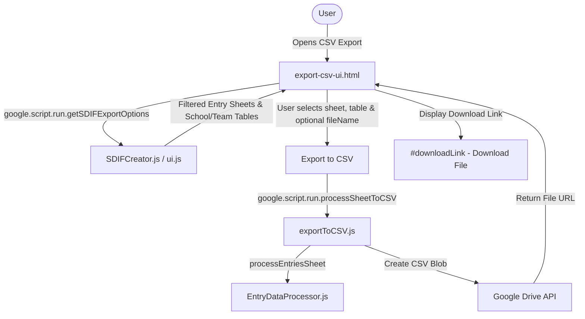

# Requirements

### Overview & Goals
Align the **Export to CSV** modal dialog (`export-csv-ui.html`) with the layout, functionality, field structure, and download link styling of the **Export for Meet Manager** dialog (`SDIFCreator_Dialog.html`). This ensures a unified, intuitive user experience across all export workflows in the Swim Entries Manager Add-on.

### Scope
- **In Scope:**
  - Redesign `export-csv-ui.html` using the standard dialog layout (`.header`, `.section`, `.section-label`, `.field`, `.download-link`) from `shared-dialog-styles.html`.
  - Update the **Entries Sheet** dropdown to use filtered candidate entry sheets via `getSDIFExportOptions()`, excluding system/reserved sheets (`Meet`, `Events`, `Schools`, `Teams`, `Team Officials`, `Sheet1`, hidden sheets).
  - Update the team code table selector to a dropdown labeled **School/Team Table Name** with auto-detection of `Schools` / `Teams` sheets.
  - Add an optional **Output File Name** text input field with placeholder hint `Leave blank for auto-generation`.
  - Style the export button with standard SVG icon and update the result download link to match the `.download-link` / `Download File` container of the Meet Manager dialog.
  - Update `exportToCSV.js` to simplify dialog initialization and support custom output file names in `processSheetToCSV(sheetNameOrId, teamCodeTableName, fileName)`.
  - Add unit verification test in `tests.js` and update user documentation in `docs/USER_GUIDE.md` and `docs/SWIM_ENTRIES_MANAGER_SPEC.md`.
- **Out of Scope:**
  - Modifying the underlying swimmer entry parsing rules in `EntryDataProcessor.js`.
  - Altering the CSV output column structure (`Team Code`, `First Name`, `Last Name`, `Date of Birth`, `Gender`, `Event Entries`, `Entry Times`, `School Year`).

### User Stories
- **As a Meet Organizer**, I want the CSV export dialog to have the same clear layout, field labels, and sheet filtering as the Meet Manager export dialog so that my workflow is consistent across both export types.
- **As a Meet Organizer**, I want to specify an optional custom output file name for my CSV export so that downloaded files are immediately identifiable.
- **As a Meet Organizer**, I want the download link to appear as a prominent, styled "Download File" link below the status message once CSV generation completes.

### Functional Requirements
- **Header:**
  - Displays description: `Export swimmer entries to CSV format for manual processing or external tools.`
- **Fields:**
  - **Entries Sheet Dropdown (`sheetSelect`):** Populated dynamically with filtered candidate entry sheets (excluding reserved/hidden sheets, including template and derived sheets).
  - **School/Team Table Name Dropdown (`schoolsTable`):** Labeled `School/Team Table Name`, dynamically populated with detected `Schools` / `Teams` tables and auto-selected.
  - **Output File Name Input (`fileName`):** Labeled `Output File Name` with `auto-generated if blank`, placeholder `Leave blank for auto-generation`.
- **Action & Feedback:**
  - **Export Button:** Labeled `Export to CSV`, disabled during generation with loading status.
  - **Status Area (`#status`):** Displays `"Exporting entries to CSV... please wait."` during execution, followed by `"Successfully exported!"` or actionable error messages.
  - **Download Link (`#downloadLink.download-link`):** Renders styled `<a href="..." id="fileUrl" target="_blank">Download File</a>` container on success, hidden during processing or upon error.

# Technical Design

### Current Implementation
- `export-csv-ui.html` uses synchronous server-side template evaluation (`sheetOptionsHtml` and `tableOptionsHtml`) generated by `exportEntriesToCSV()` in `exportToCSV.js`.
- It lists all visible sheets (including `Meet`, `Events`, `Schools`, etc.) without entry sheet filtering heuristics.
- The team table is labeled `Team Code Table` with subtext and includes all TableApp/sheet names rather than focused `Schools` / `Teams` detection.
- No `Output File Name` input is provided; the output file is always named `${sheetName}.csv`.
- Upon success, it inserts an inline link into `#status` (`'Success! <a href="...">Download CSV</a>'`) rather than using the dedicated `.download-link` styled container.

### Key Decisions
1. **Asynchronous Options Loading via `getSDIFExportOptions()`**:
   - *Decision:* Reuse the server-side export options provider `getSDIFExportOptions()` in client-side initialization of `export-csv-ui.html`.
   - *Rationale:* Eliminates code duplication, leverages existing sheet exclusion heuristics and School/Team detection, and keeps dialog opening instantaneous.
2. **Backward-Compatible `processSheetToCSV` Signature**:
   - *Decision:* Update `processSheetToCSV(sheetNameOrId, teamCodeTableName, fileName)` to accept sheet name (or sheet ID as fallback) and optional `fileName`.
   - *Rationale:* Aligns parameter naming with `processSheetToSd3` while preserving backward compatibility.
3. **Download Link & Exception Handling Styling**:
   - *Decision:* Adopt the exact `#downloadLink.download-link` structure and styling defined in `shared-dialog-styles.html`.
   - *Rationale:* Ensures visual consistency across Meet Manager export and CSV export modals.

### Proposed Changes
- **`export-csv-ui.html`**:
  - Replace legacy template-rendered dropdowns with dynamic `<select id="sheetSelect">` and `<select id="schoolsTable">`.
  - Add `<input type="text" id="fileName" placeholder="Leave blank for auto-generation">`.
  - Add `
<a href="#" id="fileUrl" target="_blank">Download File</a>
`.
  - Implement client script calling `google.script.run.getSDIFExportOptions()` and `processSheetToCSV(sheetName, schoolsTable, fileName)`.
- **`exportToCSV.js`**:
  - Refactor `exportEntriesToCSV()` to directly open `export-csv-ui.html` without heavy synchronous preprocessing.
  - Update `processSheetToCSV(sheetNameOrId, teamCodeTableName, fileName)` to resolve sheet by name/ID and format output file name (defaulting to `${sheetName}.csv` if blank).
- **`tests.js`**:
  - Add `testCSVExportFileNameAndResolution()` to verify sheet resolution and file naming logic.
- **`docs/USER_GUIDE.md` & `docs/SWIM_ENTRIES_MANAGER_SPEC.md`**:
  - Update CSV export screenshots, field descriptions, and functional specs.

### Architecture Diagram

### File Structure
- `export-csv-ui.html`: Redesigned HTML layout and client-side JavaScript.
- `exportToCSV.js`: Streamlined dialog launcher and updated `processSheetToCSV` implementation.
- `tests.js`: Added unit diagnostic tests for CSV export sheet and filename resolution.
- `docs/USER_GUIDE.md`: Updated CSV export user guide documentation.
- `docs/SWIM_ENTRIES_MANAGER_SPEC.md`: Updated CSV export specification requirements.

### Risks & Mitigations
- **Risk:** Existing calls or legacy scripts passing numerical `sheetId` instead of `sheetName` to `processSheetToCSV`.
  - *Mitigation:* In `processSheetToCSV`, check `ss.getSheetByName(sheetNameOrId)` first; if not found, fall back to `ss.getSheetById(sheetNameOrId)`.
- **Risk:** User provides a custom file name without `.csv` extension or with special characters.
  - *Mitigation:* Sanitize file name and append `.csv` automatically if omitted.

# Testing

### Validation Approach
Verify CSV export dialog rendering, dynamic option population, custom and default file naming, and CSV file creation via unit tests and mock spreadsheet executions.

### Key Scenarios
1. **Dialog Initialization**:
   - Open CSV export dialog on a workbook containing entry sheets, configuration sheets (`Meet`, `Events`, `Schools`), and `Sheet1`.
   - **Expected:** `Entries Sheet` dropdown lists only valid entry sheets; `School/Team Table Name` lists and pre-selects `Schools` or `Teams`.
2. **Export with Default File Name**:
   - Leave `Output File Name` blank and click `Export to CSV`.
   - **Expected:** Generates CSV named `${sheetName}.csv`, shows `Successfully exported!`, and displays the `Download File` button.
3. **Export with Custom File Name**:
   - Enter `Hamilton_Primary_Entries` in `Output File Name` and click `Export to CSV`.
   - **Expected:** Generates CSV named `Hamilton_Primary_Entries.csv` with correct download URL.
4. **Error Handling**:
   - No entry sheets selected or invalid team table.
   - **Expected:** Actionable error message displayed in `#status` with red text formatting; button re-enabled.

### Edge Cases
- Custom file name provided already includes `.csv` (e.g. `MyEntries.csv`) — verify `.csv.csv` is not produced.
- Workbook uses `Teams` table (Age Group meet) instead of `Schools` — verify `Teams` is pre-selected and team codes are resolved properly.

# Delivery Steps

### ✓ Step 1: Update CSV export backend in exportToCSV.js
The server provides a streamlined dialog launcher and an enhanced `processSheetToCSV` function supporting custom file names and flexible sheet resolution.

- Simplify `exportEntriesToCSV()` to evaluate `export-csv-ui.html` directly without redundant synchronous table lookups.
- Update `processSheetToCSV(sheetNameOrId, teamCodeTableName, fileName)` to support resolving sheets by name or ID.
- Add output file name handling that sanitizes custom file names and defaults to `${sheetName}.csv` when blank.

### ✓ Step 2: Redesign export-csv-ui.html layout and client-side integration
The CSV export dialog UI matches the layout, field structure, and download link styling of the Meet Manager export dialog.

- Update dialog header description to reflect CSV export functionality.
- Reorganize input fields into an `Export` section with `Entries Sheet` dropdown, `School/Team Table Name` dropdown, and `Output File Name` text input.
- Replace inline status download link with `#downloadLink.download-link` containing `<a id="fileUrl">Download File</a>`.
- Implement client-side JavaScript to load options via `google.script.run.getSDIFExportOptions()` and submit export requests with loading and error states.

### ✓ Step 3: Add diagnostic verification tests and update documentation
CSV export functionality is validated with unit tests and documented in user guides and specifications.

- Add `testCSVExportFileNameAndResolution()` in `tests.js` covering sheet resolution, custom file naming, and default naming.
- Update `docs/USER_GUIDE.md` with the new CSV export dialog fields, screenshot descriptions, and download instructions.
- Update `docs/SWIM_ENTRIES_MANAGER_SPEC.md` to reflect the updated dialog fields and filtering behavior for CSV export.