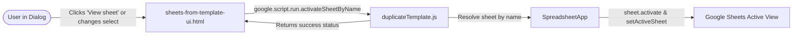

# Requirements

### Overview & Goals
Provide a modern, minimal mechanism in the **Create Sheets from Template** modal dialog (`sheets-from-template-ui.html`) to activate and view the selected School/Team sheet in the background spreadsheet behind the dialog. This allows users to easily see and verify the cell range containing school or team names without having to cancel or reopen the dialog.

### Scope
- **In Scope:**
  - Add a server-side helper function `activateSheetByName(sheetName)` to activate the specified sheet in Google Sheets while the dialog remains open.
  - Add a sleek, minimal, modern UI control ("View sheet" / "Switch to sheet" action button/link with icon) in `sheets-from-template-ui.html` adjacent to the School/Team table dropdown.
  - Implement client-side event handling to trigger background sheet switching on demand and when the source table selection changes.
  - Provide reusable minimal button/action styles in `shared-dialog-styles.html` consistent with the project's design system.
  - Add diagnostic unit tests in `tests.js` verifying sheet resolution and activation error handling.
  - Update user documentation in `docs/USER_GUIDE.md` and functional specifications in `docs/SWIM_ENTRIES_MANAGER_SPEC.md`.
- **Out of Scope:**
  - Modifying the template duplication logic itself (`duplicateTemplateForNames`).
  - Converting modal dialogs into modeless dialogs or sidebars.

### User Stories
- **As a Meet Organizer**, I want to be able to switch the visible sheet behind the Create Sheets from Template dialog to my `Schools` or `Teams` sheet so that I can look at the actual row coordinates and verify my name range (e.g., `A2:A20` or `B2:B8`) without closing the dialog.
- **As a User**, I want the UI control to be subtle and modern so that it does not visually clutter the dialog or compete with primary actions.

### Functional Requirements
- **Sheet Activation Mechanism:**
  - Provide a server-side `activateSheetByName(sheetName)` function that resolves the sheet (exact match or case-insensitive fallback) and calls `SpreadsheetApp.setActiveSheet(sheet)` / `sheet.activate()`.
  - Provide clean error feedback if the requested sheet does not exist.
- **Dialog UI Integration:**
  - In `sheets-from-template-ui.html`, add a minimal action link/button (e.g. `View sheet` with a subtle eye or external-link icon) in the field header above or next to the `Sheet with names of Schools/Teams` dropdown.
  - Ensure the button is lightweight, compact, and non-intrusive (no large primary buttons).
  - Clicking "View sheet" activates the currently selected sheet from the dropdown in the spreadsheet.
  - Optionally activate the sheet automatically when the user changes the dropdown selection.
- **Visual Design & Feedback:**
  - Styled with subtle hover states, compact padding, rounded corners, and theme colors (`#0397B3`), fitting the existing design tokens in `shared-dialog-styles.html`.
  - Provide immediate subtle feedback (e.g. temporary tooltip or icon state change) without blocking user input.

# Technical Design

### Current Implementation
- `sheets-from-template-ui.html` opens as a modal dialog (`SpreadsheetApp.getUi().showModalDialog`).
- Google Sheets modal dialogs display a translucent overlay blocking direct mouse clicks on sheet tabs.
- However, client-side scripts inside modal dialogs can invoke `google.script.run` to call server-side Google Apps Script methods, which can programmatically activate sheets using `sheet.activate()` and `ss.setActiveSheet(sheet)`.

### Key Decisions
1. **Server-Side Sheet Activation (`activateSheetByName`)**:
   - *Decision:* Implement `activateSheetByName(sheetName)` in `duplicateTemplate.js` (or `ui.js`) supporting exact and case-insensitive matching.
   - *Rationale:* Ensures reliable activation even if minor casing discrepancies exist.
2. **Modern Minimal UI Pattern**:
   - *Decision:* Place a subtle text+icon action button (`.btn-subtle` / `.field-action-link`) inside a flex `.field-header` row directly above the dropdown (aligning label on the left and action button on the right).
   - *Rationale:* Keeps the layout clean, uncluttered, and intuitive while adhering to modern Google Workspace UI standards without large button distraction.
3. **Triggering Behavior**:
   - *Decision:* Support both manual trigger via the "View sheet" button and automatic activation when the user changes the dropdown selection.
   - *Rationale:* Provides zero-friction switching when selecting tables while giving users an explicit button to re-activate the sheet at any point.

### Proposed Changes
- **`duplicateTemplate.js`**:
  - Implement `activateSheetByName(sheetName)`: resolves the sheet and calls `ss.setActiveSheet(sheet)` and `sheet.activate()`.
- **`shared-dialog-styles.html`**:
  - Add styles for `.field-header` (flex layout with space-between) and `.btn-subtle` (compact font, minimal padding, subtle border/background, smooth hover state, icon support).
- **`sheets-from-template-ui.html`**:
  - Update markup to wrap the `Sheet with names of Schools/Teams` label and action button in a `.field-header`.
  - Add client-side click handler for `#viewSheetBtn` and `change` handler on `#sheet` to invoke `google.script.run.activateSheetByName(...)`.
- **`tests.js`**:
  - Add `testActivateSheetByName()` verifying exact match, case-insensitive match, and error reporting for missing sheets.
  - Wire into `runAllDiagnosticTests()`.
- **`docs/USER_GUIDE.md` & `docs/SWIM_ENTRIES_MANAGER_SPEC.md`**:
  - Document the "View sheet" feature under Step 2 of the user guide and update the functional specification.

### Architecture Diagram

### File Structure
- `duplicateTemplate.js`: Added `activateSheetByName(sheetName)` server-side handler.
- `shared-dialog-styles.html`: Added `.field-header` and `.btn-subtle` minimal action button styles.
- `sheets-from-template-ui.html`: Added "View sheet" action button and client-side activation triggers.
- `tests.js`: Added unit diagnostic tests for sheet activation.
- `docs/USER_GUIDE.md`: Updated Step 2 documentation to describe the background sheet preview.
- `docs/SWIM_ENTRIES_MANAGER_SPEC.md`: Updated functional specification for sheet switching.

### Risks & Mitigations
- **Risk:** Sheet cannot be activated because it is hidden.
  - *Mitigation:* Unhide or verify visibility before activation, returning a friendly message if hidden.
- **Risk:** Dialog UI feels cluttered or buttons feel too prominent.
  - *Mitigation:* Use flat, borderless/subtle-border styling with small typography (11px–12px) and a minimal 14px icon.

# Testing

### Validation Approach
Verify server-side sheet resolution and activation routines in `tests.js`, and validate client-side UI rendering and event dispatch.

### Key Scenarios
1. **Manual Click on "View Sheet"**:
   - User selects `Schools` in dropdown and clicks "View sheet".
   - **Expected:** Active sheet in Google Sheets switches to `Schools` behind the dialog.
2. **Dropdown Selection Change**:
   - User switches dropdown from `Schools` to `Teams`.
   - **Expected:** Active sheet in Google Sheets switches to `Teams` behind the dialog.
3. **Sheet Resolution**:
   - Sheet name with mixed casing (e.g. `schools` vs `Schools`) is correctly resolved and activated.
4. **Non-Existent Sheet**:
   - If an invalid sheet name is passed, an error is caught and reported gracefully without breaking dialog state.

# Delivery Steps

### ✓ Step 1: Implement server-side activateSheetByName and shared minimal UI styles
Expose the server-side sheet activation helper and add reusable minimal action button styles.

- Add `activateSheetByName(sheetName)` in `duplicateTemplate.js` with case-insensitive sheet resolution and activation.
- Add `.field-header` and `.btn-subtle` / `.btn-icon-subtle` CSS classes in `shared-dialog-styles.html`.
- Add unit diagnostic test `testActivateSheetByName()` in `tests.js` and connect it to `runAllDiagnosticTests()`.

### ✓ Step 2: Update Create Sheets dialog UI and client-side activation logic
Integrate the minimal "View sheet" action into the Create Sheets from Template dialog.

- In `sheets-from-template-ui.html`, update the `Team Names Source` section with a `.field-header` containing the label and a minimal `View sheet` button with an SVG icon.
- Add client-side event handlers for button click and dropdown change calling `google.script.run.activateSheetByName()`.
- Update user guide in `docs/USER_GUIDE.md` and specification in `docs/SWIM_ENTRIES_MANAGER_SPEC.md`.