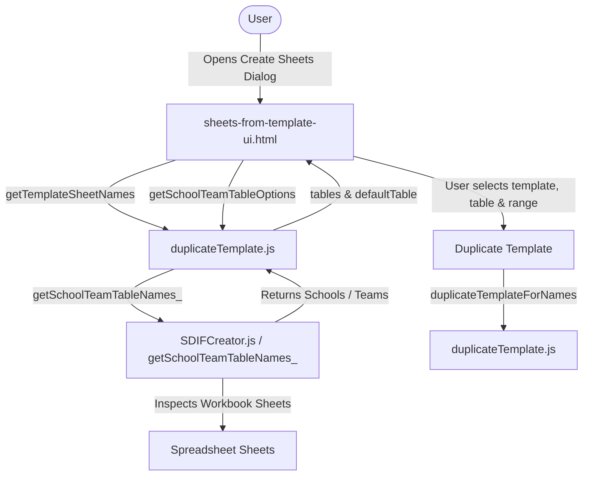

# Requirements

### Overview & Goals
Improve the **Create Sheets from Template** modal dialog (`sheets-from-template-ui.html`) by filtering the dropdown under **Team Names Source** (`Sheet with names of Schools/Teams`). Align its behavior with the **School/Team Table Name** field in the SDIF and CSV export dialogs, excluding irrelevant sheets (`Meet`, `Events`, `Team Officials`, `Sheet1`, custom entry sheets) and retaining only `Schools` or `Teams` (auto-detected from the active workbook).

### Scope
- **In Scope:**
  - Update `sheets-from-template-ui.html` so the **Sheet with names of Schools/Teams** dropdown is populated exclusively with detected `Schools` / `Teams` sheets.
  - Auto-select the detected table (`Schools` for school/college meets, `Teams` for age-group/club meets).
  - Provide server-side helper `getSchoolTeamTableOptions()` in `duplicateTemplate.js` leveraging `getSchoolTeamTableNames_()` to filter and return available School/Team tables and default selection.
  - Ensure robust resolution in `duplicateTemplateForNames()` when reading the selected sheet.
  - Add unit verification tests in `tests.js` covering School/Team table filtering for template sheet duplication.
  - Update user documentation in `docs/USER_GUIDE.md` and `docs/SWIM_ENTRIES_MANAGER_SPEC.md`.
- **Out of Scope:**
  - Modifying the template duplication logic itself (creating and renaming sheets, preserving cell validations).
  - Altering the relay table generation dialog (`relay-ui-full.html`).

### User Stories
- **As a Meet Organizer**, I want the "Sheet with names of Schools/Teams" dropdown in the Create Sheets from Template dialog to only display valid organization sheets (`Schools` or `Teams`) so that I don't accidentally select non-organization sheets like `Meet`, `Events`, or `Sheet1`.
- **As a Meet Organizer**, I want the dialog to automatically pre-select whichever of `Schools` or `Teams` exists in my workbook so that I don't have to search through a list of all workbook sheets.

### Functional Requirements
- **Template Section:**
  - **Template Sheet Name Dropdown (`templateName`):** Lists available template sheets (containing `"TEMPLATE"` in the name).
- **Team Names Source Section:**
  - **Sheet with names of Schools/Teams Dropdown (`sheet`):**
    - Populated exclusively with `Schools` and/or `Teams` sheets detected in the active spreadsheet (case-insensitively).
    - If both exist, lists both with `Schools` first.
    - If only `Teams` exists, lists `Teams` and pre-selects it.
    - If only `Schools` exists, lists `Schools` and pre-selects it.
    - If neither exists yet, provides fallback options `['Schools', 'Teams']` with `Schools` pre-selected.
    - Filters out all non-organization sheets (`Meet`, `Events`, `Team Officials`, `Sheet1`, template sheets, and individual entry sheets).
  - **Range with names Input (`range`):** Retains default value `"A2:A8"` with hint `e.g., A2:A8`.
- **Execution & Feedback:**
  - Retains existing button labeling, progress status, and sheet creation alerts.

# Technical Design

### Current Implementation
- `sheets-from-template-ui.html` currently calls `google.script.run.getNonTemplateSheetNames()`.
- `getNonTemplateSheetNames()` in `duplicateTemplate.js` simply returns every sheet whose name does not contain `"TEMPLATE"`. This exposes every sheet in the workbook (`Meet`, `Events`, `Schools`, `Teams`, `Team Officials`, `Takapuna Primary`, `Sheet1`, etc.) in the dropdown.
- `duplicateTemplateForNames(templateSheetName, sheetName, namesRange)` reads the cell values from the specified sheet and range to duplicate the template.

### Key Decisions
1. **Reuse `getSchoolTeamTableNames_()` Logic**:
   - *Decision:* Expose a dedicated server-side function `getSchoolTeamTableOptions()` in `duplicateTemplate.js` that delegates to `getSchoolTeamTableNames_(ss)`.
   - *Rationale:* Ensures 100% consistency with SDIF export (`SDIFCreator.js`) and CSV export (`exportToCSV.js`), avoiding divergent filtering rules or duplicated code.
2. **Auto-Selection & Client-Side Rendering**:
   - *Decision:* Return `{ tables: string[], defaultTable: string }` to `sheets-from-template-ui.html`, populating `<select id="sheet">` and setting `select.value = options.defaultTable`.
   - *Rationale:* Eliminates manual user selection errors when switching between school competitions (using `Schools`) and age-group meets (using `Teams`).
3. **Preserve Backward Compatibility**:
   - *Decision:* Retain `getNonTemplateSheetNames()` in `duplicateTemplate.js` for any legacy callers or relay UI references while switching `sheets-from-template-ui.html` to `getSchoolTeamTableOptions()`.
   - *Rationale:* Prevents breaking any external or secondary dialogs that still rely on `getNonTemplateSheetNames()`.

### Proposed Changes
- **`duplicateTemplate.js`**:
  - Add `getSchoolTeamTableOptions()` returning `{ tables: string[], defaultTable: string }`.
  - Ensure sheet lookup in `duplicateTemplateForNames()` uses case-insensitive fallback if needed.
- **`sheets-from-template-ui.html`**:
  - Update `loadSourceSheets()` to call `google.script.run.getSchoolTeamTableOptions()`.
  - Populate `<select id="sheet">` with filtered options and auto-select `defaultTable`.
- **`tests.js`**:
  - Add `testCreateSheetsSourceTableFiltering()` verifying filtered tables and default selection across various workbook configurations (`Schools` only, `Teams` only, both, neither, and exclusion of `Meet`/`Events`/`Sheet1`).
  - Wire into `runAllDiagnosticTests()`.
- **`docs/USER_GUIDE.md` & `docs/SWIM_ENTRIES_MANAGER_SPEC.md`**:
  - Update documentation for Step 2 ("Create Sheets from Templates") detailing the filtered dropdown and auto-selection of `Schools` / `Teams`.

### Architecture Diagram

### File Structure
- `duplicateTemplate.js`: Added `getSchoolTeamTableOptions()` and enhanced sheet resolution.
- `sheets-from-template-ui.html`: Updated client-side `loadSourceSheets()` to use filtered options and auto-select default table.
- `tests.js`: Added unit diagnostic tests for source table filtering in template duplication.
- `docs/USER_GUIDE.md`: Updated user guide for Step 2 (Create Sheets from Templates).
- `docs/SWIM_ENTRIES_MANAGER_SPEC.md`: Updated specification for sheet duplication interface.

### Risks & Mitigations
- **Risk:** Neither `Schools` nor `Teams` sheet has been created yet when opening the dialog.
  - *Mitigation:* Fall back to providing `['Schools', 'Teams']` with `Schools` selected, matching the export dialogs.
- **Risk:** Existing callers or custom scripts expect `getNonTemplateSheetNames()` to remain available.
  - *Mitigation:* Keep `getNonTemplateSheetNames()` intact and untouched in `duplicateTemplate.js`.

# Testing

### Validation Approach
Verify the filtered dropdown options, default table selection, and sheet duplication workflow across different meet setups (School vs Age Group) via unit tests in `tests.js` and dialog inspection.

### Key Scenarios
1. **School Meet Workbook**:
   - Workbook has `Meet`, `Events`, `Schools`, `Team Officials`, `Individual Entries Template`, `Takapuna Primary`, `Sheet1`.
   - **Expected:** Dropdown contains ONLY `Schools` and is auto-selected.
2. **Age Group / Club Meet Workbook**:
   - Workbook has `Meet`, `Events`, `Teams`, `Team Officials`, `Individual Entries Template`, `North Shore`.
   - **Expected:** Dropdown contains ONLY `Teams` and is auto-selected.
3. **Workbook with Both `Schools` and `Teams`**:
   - Workbook has both `Schools` and `Teams` sheets.
   - **Expected:** Dropdown lists both `Schools` and `Teams` with `Schools` selected by default.
4. **Fresh / Blank Workbook**:
   - Workbook has only `Sheet1` and `Individual Entries Template`.
   - **Expected:** Dropdown provides `Schools` and `Teams` fallback with `Schools` selected.

### Edge Cases
- Case differences in sheet names (`schools`, `TEAMS`) are handled seamlessly.
- Non-organization sheets like `Meet`, `Events`, `Team Officials`, `Sheet1` are never present in the source sheet dropdown.

# Delivery Steps

### ✓ Step 1: Implement getSchoolTeamTableOptions and client-side dropdown filtering
Expose the server-side table options helper and update the Create Sheets from Template dialog to display only `Schools` or `Teams`.

- Add `getSchoolTeamTableOptions()` in `duplicateTemplate.js` returning `{ tables: string[], defaultTable: string }` powered by `getSchoolTeamTableNames_()`.
- Update `sheets-from-template-ui.html` `loadSourceSheets()` to call `google.script.run.getSchoolTeamTableOptions()`.
- Populate `<select id="sheet">` with detected options and set the selected value to `defaultTable`.
- Ensure graceful fallback if no source tables or options are returned.

### ✓ Step 2: Add diagnostic verification tests and update documentation
Verify source table filtering with unit tests in `tests.js` and update user guides and specifications.

- Add `testCreateSheetsSourceTableFiltering()` in `tests.js` covering School, Age Group, dual-table, and fallback scenarios.
- Include `testCreateSheetsSourceTableFiltering()` in `runAllDiagnosticTests()`.
- Update `docs/USER_GUIDE.md` under Step 2 to document the filtered `Schools` / `Teams` dropdown.
- Update `docs/SWIM_ENTRIES_MANAGER_SPEC.md` to reflect the updated dialog fields and filtering behavior.