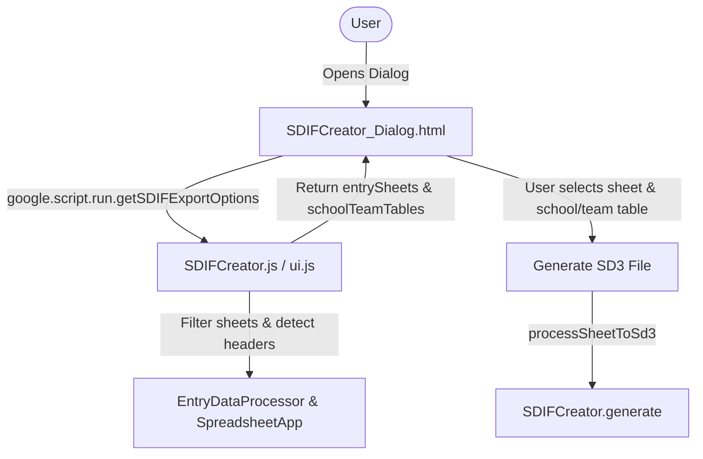

# Requirements

### Overview & Goals
Enhance the **Export for Meet Manager** dialog (`SDIFCreator_Dialog.html`) to improve user experience, minimize input errors, and prevent exporting non-entry sheets into Hy-Tek Meet Manager SDIF format.

### Scope
- **In Scope:**
  - Filter the **Entries Sheet** dropdown to exclude non-entry system/core sheets (`Meet`, `Events`, `Schools`, `Teams`, `Team Officials`, `Sheet1`, hidden sheets) while including `Individual Entries Template` and all derived entry sheets.
  - Implement a lightweight, reliable heuristic to verify candidate entry sheets (e.g., checking for standard entry header markers).
  - Retain the **Meet Table Name** input as a free-text field with default value `"Meet"`.
  - Convert the **Schools Table Name** text input into a dropdown labeled `School/Team Table Name` that automatically detects whether the workbook uses `Schools` or `Teams`.
  - Update user documentation (`docs/USER_GUIDE.md`, `docs/SWIM_ENTRIES_MANAGER_SPEC.md`).
- **Out of Scope:**
  - Modifying the underlying SDIF v3 generation algorithms or record formatting in `SDIFCreator.js`.
  - Altering the CSV export dialog (`export-csv-ui.html`).

### User Stories
- **As a Meet Organizer**, I want the Entries dropdown to only display valid entry sheets so that I do not accidentally select configuration or metadata sheets like `Meet` or `Schools`.
- **As a Meet Organizer**, I want the School/Team table field to be a dropdown that automatically locates the `Schools` or `Teams` sheet so that I don't have to manually remember or type the table name for different competition types (School vs Age Group).

### Functional Requirements
- **Entries Sheet Dropdown:**
  - Must filter out hidden sheets.
  - Must filter out reserved sheets case-insensitively: `Meet`, `Events`, `Schools`, `Teams`, `Team Officials`, `Sheet1` (and `Sheet 1`).
  - Must include `Individual Entries Template` and any sheets duplicated or derived from it.
  - Candidate sheets must have swimmer entry headers (e.g. `First Name`, `Last Name`, `DOB`, or `Gender`).
- **Meet Table Name Field:**
  - Remains a text input with default value `"Meet"`.
- **School/Team Table Name Field:**
  - Displays label: `School/Team Table Name`.
  - Implemented as a `<select>` dropdown.
  - Options populated with detected matching sheets/tables in the workbook (searching for `Schools` and `Teams`).
  - Automatically selects `Schools` if present; if only `Teams` is present, selects `Teams`. If neither is found, provides a fallback option or allows manual selection.
- **Export Processing:**
  - Submits the selected `sheetName`, `meetTable`, `schoolsTable`, and optional `fileName` to `processSheetToSd3` as before.

# Technical Design

### Current Implementation
- `SDIFCreator_Dialog.html` currently populates `sheetSelect` using `google.script.run.getVisibleSheetNames()`, which returns every non-hidden sheet in the spreadsheet without filtering out configuration tables (`Meet`, `Events`, `Schools`, etc.).
- `meetTable` and `schoolsTable` are plain `<input type="text">` fields with static defaults `"Meet"` and `"Schools"`.
- Age Group, Open, and Masters competitions configure their organization table as `Teams` rather than `Schools` (defined in `tableConfig.js`), requiring manual editing of the `schoolsTable` input by users.

### Key Decisions
1. **Server-Side Option Provider (`getSDIFExportOptions`)**:
   - *Decision:* Provide a single server-side function `getSDIFExportOptions()` returning `{ entrySheets: string[], schoolTeamTables: string[], defaultSchoolTeamTable: string }`.
   - *Rationale:* Minimizes round-trips between client dialog and Apps Script backend, keeping dialog initialization fast and atomic.
2. **Entry Sheet Filtering Heuristic**:
   - *Decision:* Combine exact name exclusion of reserved sheets (`Meet`, `Events`, `Schools`, `Teams`, `Team Officials`, `Sheet1`, `Sheet 1`) with an inspection of sheet headers (looking for swimmer fields like `First Name`, `Last Name`, `DOB`, or `Gender` via `EntryDataProcessor.js` column mapping logic).
   - *Rationale:* Completely prevents non-entry sheets from appearing while reliably supporting any custom-named school or cluster sheets derived from `Individual Entries Template`.
3. **School/Team Table Resolution**:
   - *Decision:* Inspect existing sheets in the spreadsheet for `Schools` and `Teams`. If both exist, list both with `Schools` first. If only one exists, list and pre-select that one. If neither exists, provide both as selectable options with a warning/hint.

### Proposed Changes
- **`SDIFCreator.js` / `ui.js`**:
  - Add `getSDIFExportOptions()` to retrieve filtered entry sheets and detected School/Team tables.
  - In `getEntriesSheetNames_()`, apply exclusion list and header detection.
  - In `getSchoolTeamTableNames_()`, detect presence of `Schools` / `Teams`.
- **`SDIFCreator_Dialog.html`**:
  - Replace `<input type="text" id="schoolsTable" value="Schools">` with `<select id="schoolsTable"></select>`.
  - Update label to `School/Team Table Name`.
  - Keep `<input type="text" id="meetTable" value="Meet">`.
  - Update initialization script to populate both `sheetSelect` and `schoolsTable` from `getSDIFExportOptions()`.
- **`docs/USER_GUIDE.md`**:
  - Update the dialog screenshot/field descriptions in the Export for Meet Manager guide.

### Architecture Diagram

### File Structure
- `SDIFCreator_Dialog.html`: Updated HTML layout (dropdown for School/Team Table Name) and client initialization script.
- `SDIFCreator.js`: Exposed `getSDIFExportOptions()` and helper functions for entry sheet filtering and table detection.
- `docs/USER_GUIDE.md`: Updated user guide documentation for the export dialog.

### Risks & Mitigations
- **Risk:** User renamed an entry sheet with non-standard column headers, causing it to be filtered out.
  - *Mitigation:* Ensure header matching uses the robust, case-insensitive detection already in `EntryDataProcessor.js` and always includes any sheet containing `"Individual Entries"` or `"Template"`.
- **Risk:** Spreadsheet has neither `Schools` nor `Teams` created yet when opening export dialog.
  - *Mitigation:* Populate dropdown with standard defaults (`Schools`, `Teams`) and display a clear validation message if generation is attempted before creating tables.

# Testing

### Validation Approach
Verify the dialog functionality and server-side filtering across different sheet configurations and competition types in Google Apps Script.

### Key Scenarios
1. **Standard School Competition Workbook**:
   - Workbook has `Meet`, `Events`, `Schools`, `Team Officials`, `Individual Entries Template`, `Takapuna Primary`, `Sheet1`.
   - **Expected:** `Entries Sheet` dropdown contains ONLY `Individual Entries Template` and `Takapuna Primary`. `School/Team Table Name` dropdown contains `Schools` and is auto-selected.
2. **Age Group / Club Competition Workbook**:
   - Workbook has `Meet`, `Events`, `Teams`, `Team Officials`, `Aquablazers`, `North Shore`.
   - **Expected:** `Entries Sheet` dropdown contains `Aquablazers` and `North Shore`. `School/Team Table Name` dropdown contains `Teams` and is auto-selected.
3. **Export Execution**:
   - Select entry sheet and table from dropdowns, enter Meet table name and click "Generate SD3 File".
   - **Expected:** SDIF export completes successfully, honoring the selected sheet and table.

### Edge Cases
- **Blank / Default Workbook**: Only `Sheet1` exists — dropdown indicates no valid entry sheets found.
- **Both `Schools` and `Teams` Exist**: Dropdown lists both options for the user to choose.
- **Case Variations**: Sheet named `schools`, `TEAMS`, or `sheet1` are handled correctly without case-sensitivity issues.

# Delivery Steps

### ✓ Step 1: Implement server-side sheet filtering and School/Team table detection
The server exposes helper functions that return filtered entry sheet candidates and available School/Team table options.

- Add a server-side helper `getSDIFExportOptions()` (or `getEntriesSheetNames()` and `getSchoolTeamTableNames()`) in `SDIFCreator.js` (and/or `ui.js`).
- Implement entry sheet filtering that excludes non-entry sheets (`Meet`, `Events`, `Schools`, `Teams`, `Team Officials`, `Sheet1`, and hidden sheets) while preserving `Individual Entries Template` and sheets derived from it.
- Add an entry sheet header check verifying swimmer column signatures (`First Name`, `Last Name`, or `DOB`/`Gender`) to filter out irrelevant custom sheets.
- Implement detection of available school/team tables by checking for sheets named `Schools` and `Teams`, determining the best default based on meet competition type or sheet existence.

### ✓ Step 2: Update Export for Meet Manager dialog UI and client-side integration
The Export for Meet Manager modal dialog renders a filtered Entries dropdown and a dynamic School/Team table selector.

- In `SDIFCreator_Dialog.html`, update the field label from `Schools Table Name` to `School/Team Table Name`.
- Replace the `schoolsTable` text input with a `<select id="schoolsTable">` dropdown.
- Keep the `meetTable` text input field as it is with default value `"Meet"`.
- Update the client-side JavaScript to load filtered entry sheets and detected School/Team options via `google.script.run`.
- Add auto-selection logic for `schoolsTable` (defaulting to whichever of `Schools` or `Teams` exists in the spreadsheet).
- Maintain existing submission handler calling `processSheetToSd3(sheetName, meetTable, schoolsTable, fileName)`.

### ✓ Step 3: Update project documentation
User guides and specifications accurately describe the updated dialog fields and filtering behavior.

- Update `docs/USER_GUIDE.md` section on Export for Meet Manager to document the `School/Team Table Name` dropdown and entry sheet filtering.
- Update `docs/SWIM_ENTRIES_MANAGER_SPEC.md` if necessary to document the updated export dialog interface requirements.