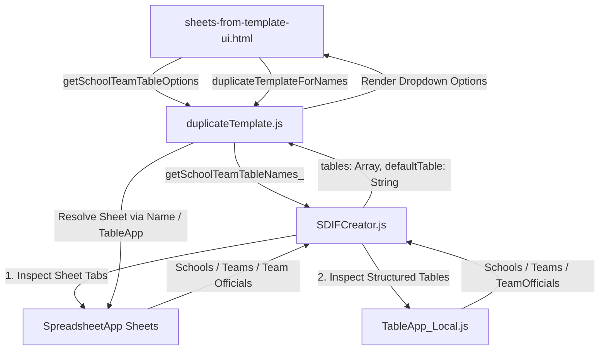

# Requirements

### Overview & Goals
In the **Create Sheets from Templates** workflow (`sheets-from-template-ui.html`), meet administrators select an organization source sheet to generate duplicate entry sheets for each school, club, or cluster. Currently, the source table detection function (`getSchoolTeamTableNames_`) filters specifically for `Schools` and `Teams` sheets while ignoring other sheets and structured tables.

To maximize operational utility and prevent administrative friction, the detection filter will be enhanced so that when either the sheet `Team Officials` (or `TeamOfficials`) or the structured TableApp table `TeamOfficials` (or `Team Officials`) exists, it is automatically recognized and provided as a selectable option in the **Sheet with names of Schools/Teams** dropdown list alongside `Schools` and `Teams`.

### Scope
#### In Scope
- **Dual-Layer Detection in `SDIFCreator.js`**: Update `getSchoolTeamTableNames_` to scan both physical spreadsheet tabs (`ss.getSheets()`) and structured tables (`TableApp.openById().getTableByName()`) for `Schools`, `Teams`, and `Team Officials` / `TeamOfficials`.
- **Whitespace & Casing Normalization**: Support case-insensitive and whitespace-stripped variations (e.g. `'team officials'`, `'teamofficials'`, `'TeamOfficials'`, `'Team Officials'`).
- **Deduplication & Casing Preservation**: Ensure that if both the sheet and the structured table exist, they resolve to a single clean dropdown entry, preserving the sheet's exact name.
- **Robust Sheet Resolution in `duplicateTemplate.js`**: Enhance `duplicateTemplateForNames` and `activateSheetByName` to resolve sheet references seamlessly when passed either a sheet name or a structured table name (mapping `table.sheetName` via `TableApp` as fallback).
- **Deterministic Selection Precedence**: Maintain default selection hierarchy: `Schools` (1st) > `Teams` (2nd) > `Team Officials` / `TeamOfficials` (3rd) > `'Schools'` fallback.
- **Automated Unit Testing in `tests.js`**: Extend test suites to validate sheet-only, table-only, combined presence, casing/spacing variations, and template duplication resolution.
- **Documentation**: Update `docs/SWIM_ENTRIES_MANAGER_SPEC.md` and `docs/USER_GUIDE.md`.

#### Out of Scope
- Modifying table schemas, column layouts, or data validation rules in `tableConfig.js`.
- Altering SDIF export file record generation or Hy-Tek formatting.

### User Stories
- **As a Meet Administrator**, I want the dropdown to include `Team Officials` whenever either the `Team Officials` sheet or `TeamOfficials` structured table exists, so that I can duplicate entry templates directly from coordinator and official rosters without manual table reconfiguration.
- **As a User**, I want the system to seamlessly activate and duplicate from the correct sheet regardless of whether `Team Officials` is named with or without spaces, eliminating runtime lookup errors.
- **As a User**, I want `Schools` or `Teams` to remain the default selection when present, ensuring optimal workflow efficiency for standard school and age-group meets.

### Functional Requirements
- **FR-1 (Sheet-Level Scan)**: `getSchoolTeamTableNames_(ss)` shall inspect all sheets in the workbook for names matching `'schools'`, `'teams'`, and `'teamofficials'` / `'team officials'` (case-insensitive, whitespace-trimmed).
- **FR-2 (TableApp Structured Table Scan)**: If `TableApp` is available (`typeof TableApp !== 'undefined'`), `getSchoolTeamTableNames_(ss)` shall check for structured tables named `Schools`, `Teams`, `TeamOfficials`, or `Team Officials`. If a table is found and its container sheet (`table.sheetName`) is not already recorded, include the resolved sheet name or table name.
- **FR-3 (Deduplication & Exact Casing)**: Detected sources shall be deduplicated so that `Team Officials` appears at most once in `tables`, preferring the exact casing of the physical sheet if present.
- **FR-4 (Default Table Selection Precedence)**:
  1. `Schools` (if present)
  2. `Teams` (if present and `Schools` absent)
  3. `Team Officials` / `TeamOfficials` (if present and both `Schools` and `Teams` absent)
  4. `'Schools'` fallback (if none of the three exist)
- **FR-5 (Fallback Output)**: If none of `Schools`, `Teams`, or `Team Officials` exist as either sheets or tables, return the standard fallback `['Schools', 'Teams']` with default `'Schools'`.
- **FR-6 (Robust Resolution in `duplicateTemplate.js`)**:
  - `duplicateTemplateForNames` and `activateSheetByName` shall resolve `sheetName` in order:
    1. Exact sheet name (`ss.getSheetByName(sheetName)`).
    2. Case-insensitive and whitespace-normalized sheet match (e.g. `'TeamOfficials'` matches sheet `'Team Officials'`).
    3. `TableApp` lookup (`tableApp.getTableByName(sheetName)?.sheetName`) resolving to the underlying container sheet.

# Technical Design

### Current Implementation
- `SDIFCreator.js` implements `getSchoolTeamTableNames_(ss)`, which iterates over `ss.getSheets()` and only matches sheet names strictly equal to `'schools'` or `'teams'`.
- `duplicateTemplate.js` defines `getSchoolTeamTableOptions()`, which delegates to `getSchoolTeamTableNames_(ss)`. `duplicateTemplateForNames()` and `activateSheetByName()` resolve sheets by exact name and case-insensitive name, but do not inspect `TableApp` tables or normalize spaces.
- `TableApp_Local.js` provides `TableApp.openById(spreadsheetId)`, enabling query of structured tables via `getTableByName(name)` and `getTables()`. Each `Table` instance exposes `getName()`, `getId()`, and `sheetName`.
- `tableConfig.js` configures the `TeamOfficials` core table with `options: { placement: { targetSheet: "Team Officials", startCell: "A1" } }`.

### Key Decisions
- **Decision 1: Dual-layer detection (Sheets + TableApp)**
  - *Rationale*: Combining sheet iteration with TableApp inspection maximizes system utility. Meet workbooks created via `tableBuilder.js` have a structured table named `'TeamOfficials'` located on sheet `'Team Officials'`. Checking both sources guarantees detection even if sheets were created manually, renamed, or generated programmatically through TableApp.
- **Decision 2: Whitespace-tolerant normalization (`team officials` / `teamofficials`)**
  - *Rationale*: Eliminates fragile string mismatch errors between the table identifier (`TeamOfficials`) and sheet title (`Team Officials`), optimizing user convenience and eliminating lookup failures.
- **Decision 3: Maintain established default priority hierarchy**
  - *Rationale*: For the vast majority of standard meets, `Schools` or `Teams` contains the primary competitor rosters. Placing `Team Officials` third in precedence provides immediate access without disrupting existing automated defaults.

### Proposed Changes

#### 1. `SDIFCreator.js`
Update `getSchoolTeamTableNames_(ss)`:
```javascript
function getSchoolTeamTableNames_(ss) {
  ss = ss || SpreadsheetApp.getActiveSpreadsheet();
  if (!ss) {
    return { tables: ['Schools', 'Teams'], defaultTable: 'Schools' };
  }

  const sheets = ss.getSheets();
  const foundNames = [];
  let hasSchools = false;
  let hasTeams = false;
  let hasTeamOfficials = false;
  let schoolsExactName = 'Schools';
  let teamsExactName = 'Teams';
  let teamOfficialsExactName = 'Team Officials';

  // 1. Scan physical sheets
  for (let i = 0; i < sheets.length; i++) {
    const sheetName = sheets[i].getName().trim();
    const lower = sheetName.toLowerCase();
    const normalized = lower.replace(/\s+/g, '');

    if (lower === 'schools' || normalized === 'schools') {
      hasSchools = true;
      schoolsExactName = sheetName;
    } else if (lower === 'teams' || normalized === 'teams') {
      hasTeams = true;
      teamsExactName = sheetName;
    } else if (lower === 'team officials' || normalized === 'teamofficials') {
      hasTeamOfficials = true;
      teamOfficialsExactName = sheetName;
    }
  }

  // 2. Scan TableApp structured tables (if available)
  if (typeof TableApp !== 'undefined' && TableApp.openById) {
    try {
      const tableApp = TableApp.openById(ss.getId());
      if (tableApp) {
        if (!hasSchools) {
          const tSchools = tableApp.getTableByName('Schools');
          if (tSchools) {
            hasSchools = true;
            schoolsExactName = tSchools.sheetName || 'Schools';
          }
        }
        if (!hasTeams) {
          const tTeams = tableApp.getTableByName('Teams');
          if (tTeams) {
            hasTeams = true;
            teamsExactName = tTeams.sheetName || 'Teams';
          }
        }
        if (!hasTeamOfficials) {
          const tOfficials = tableApp.getTableByName('TeamOfficials') || tableApp.getTableByName('Team Officials');
          if (tOfficials) {
            hasTeamOfficials = true;
            teamOfficialsExactName = tOfficials.sheetName || tOfficials.getName() || 'Team Officials';
          }
        }
      }
    } catch (e) {
      Logger.log('[getSchoolTeamTableNames_] TableApp inspection skipped/failed: %s', e.message);
    }
  }

  // 3. Assemble detected options
  if (hasSchools) foundNames.push(schoolsExactName);
  if (hasTeams) foundNames.push(teamsExactName);
  if (hasTeamOfficials && !foundNames.includes(teamOfficialsExactName)) {
    foundNames.push(teamOfficialsExactName);
  }

  if (foundNames.length === 0) {
    foundNames.push('Schools', 'Teams');
  }

  // 4. Resolve default table
  const defaultTable = hasSchools
    ? schoolsExactName
    : (hasTeams ? teamsExactName : (hasTeamOfficials ? teamOfficialsExactName : 'Schools'));

  return {
    tables: foundNames,
    defaultTable: defaultTable
  };
}
```

#### 2. `duplicateTemplate.js`
Update sheet resolution in `duplicateTemplateForNames` and `activateSheetByName`:
- When finding `sourceSheet` by `sheetName`:
  1. Try `ss.getSheetByName(sheetName)`.
  2. Try case-insensitive and space-normalized match: `s.getName().toLowerCase().replace(/\s+/g, '') === targetName.toLowerCase().replace(/\s+/g, '')`.
  3. Try `TableApp.openById(ss.getId()).getTableByName(sheetName)`: if table exists, resolve `ss.getSheetByName(table.sheetName)`.

#### 3. `tests.js`
- Update `testCreateSheetsSourceTableFiltering()`:
  - Add test case for mock workbook with `Team Officials` sheet.
  - Add test case for mock workbook with `TeamOfficials` (no space) sheet.
  - Add test case for TableApp table detection (`tableApp.getTableByName('TeamOfficials')`).
  - Add test case for standalone `Team Officials` (default selection test).
  - Add test case verifying deduplication when both TableApp table and sheet exist.
- Add test verifying `activateSheetByName` and `duplicateTemplateForNames` resolution of `TeamOfficials` table identifier to sheet `'Team Officials'`.

#### 4. Documentation
- Update `docs/SWIM_ENTRIES_MANAGER_SPEC.md` and `docs/USER_GUIDE.md` to document that `Team Officials` / `TeamOfficials` (sheet or structured table) is an eligible detected option.

### Architecture Diagram


### Data Models / Contracts
```javascript
/**
 * Detects whether Schools, Teams, or Team Officials tables/sheets exist in the spreadsheet.
 * Checks both spreadsheet tabs and TableApp structured tables.
 * @param {GoogleAppsScript.Spreadsheet.Spreadsheet} [ss] - Active spreadsheet instance
 * @return {{ tables: string[], defaultTable: string }}
 */
function getSchoolTeamTableNames_(ss)
```

### File Structure
- `SDIFCreator.js` *(modified)*: Implement dual sheet/table detection in `getSchoolTeamTableNames_`.
- `duplicateTemplate.js` *(modified)*: Implement robust sheet/table resolution in `duplicateTemplateForNames` and `activateSheetByName`.
- `tests.js` *(modified)*: Extend `testCreateSheetsSourceTableFiltering` with sheet and TableApp detection scenarios.
- `docs/SWIM_ENTRIES_MANAGER_SPEC.md` *(modified)*: Update functional specification.
- `docs/USER_GUIDE.md` *(modified)*: Update Step 2 dialog user guide.

# Testing

### Validation Approach
Automated verification will be executed via `tests.js` functions simulating Google Apps Script SpreadsheetApp and TableApp object structures, ensuring comprehensive coverage of all edge cases.

### Key Scenarios
1. **School Meet with Team Officials Sheet**:
   - Sheets: `Meet`, `Events`, `Schools`, `Team Officials`, `Individual Entries Template`
   - Expected: `tables: ['Schools', 'Team Officials']`, `defaultTable: 'Schools'`
2. **Age Group Meet with Team Officials Sheet**:
   - Sheets: `Meet`, `Events`, `Teams`, `Team Officials`, `Individual Entries Template`
   - Expected: `tables: ['Teams', 'Team Officials']`, `defaultTable: 'Teams'`
3. **Structured Table Detection (TableApp `TeamOfficials` without separate sheet match)**:
   - TableApp table: `TeamOfficials` placed on sheet `OfficialsRoster`
   - Expected: `tables: ['OfficialsRoster']` or `tables: ['Team Officials']`, `defaultTable: 'OfficialsRoster'`
4. **All Three Organization Tables Present**:
   - Sources: `Schools`, `Teams`, `TeamOfficials`
   - Expected: `tables: ['Schools', 'Teams', 'Team Officials']`, `defaultTable: 'Schools'`
5. **Only Team Officials Present**:
   - Sources: `Meet`, `Events`, `Team Officials`
   - Expected: `tables: ['Team Officials']`, `defaultTable: 'Team Officials'`
6. **No Organization Tables Present (Fallback)**:
   - Sheets: `Sheet1`, `Individual Entries Template`
   - Expected: `tables: ['Schools', 'Teams']`, `defaultTable: 'Schools'`
7. **Spacing and Casing Variations**:
   - Sheets: `teamofficials` or `team officials`
   - Expected: Preserves exact sheet casing in dropdown.
8. **Sheet Activation and Duplication Resolution**:
   - Resolving sheet name `'TeamOfficials'` when physical sheet is named `'Team Officials'`.

# Delivery Steps

### ✓ Step 1: Implement dual sheet and TableApp table detection in SDIFCreator.js and duplicateTemplate.js
`getSchoolTeamTableNames_` in `SDIFCreator.js` and resolution handlers in `duplicateTemplate.js` detect and resolve `Team Officials` / `TeamOfficials` from both sheets and structured tables.

- Update `getSchoolTeamTableNames_` in `SDIFCreator.js` to scan spreadsheet sheets for `Schools`, `Teams`, and `Team Officials` / `TeamOfficials` (case-insensitive and whitespace-normalized).
- Add `TableApp` structured table inspection in `getSchoolTeamTableNames_` to detect `TeamOfficials`, `Schools`, and `Teams` tables, mapping them to their container sheets.
- Implement deduplication and exact casing preservation when assembling the `tables` list.
- Maintain priority resolution order: `Schools` > `Teams` > `Team Officials` > fallback `'Schools'`.
- Update `duplicateTemplateForNames` and `activateSheetByName` in `duplicateTemplate.js` to support whitespace-tolerant and TableApp-based sheet resolution.

### ✓ Step 2: Update unit tests in tests.js and update documentation in docs/
Automated unit tests validate sheet and table detection, and project documentation reflects the expanded source table capabilities.

- Extend `testCreateSheetsSourceTableFiltering()` in `tests.js` to verify sheet-based detection, TableApp table-based detection, casing/spacing tolerance, and default table selection.
- Add test assertions verifying `activateSheetByName` and `duplicateTemplateForNames` resolution for `TeamOfficials` vs `Team Officials`.
- Verify `testSDIFExportOptionsFiltering()` to ensure consistent SDIF export dialog options.
- Update `docs/SWIM_ENTRIES_MANAGER_SPEC.md` and `docs/USER_GUIDE.md` to document detection of both `Team Officials` sheet and `TeamOfficials` structured table.