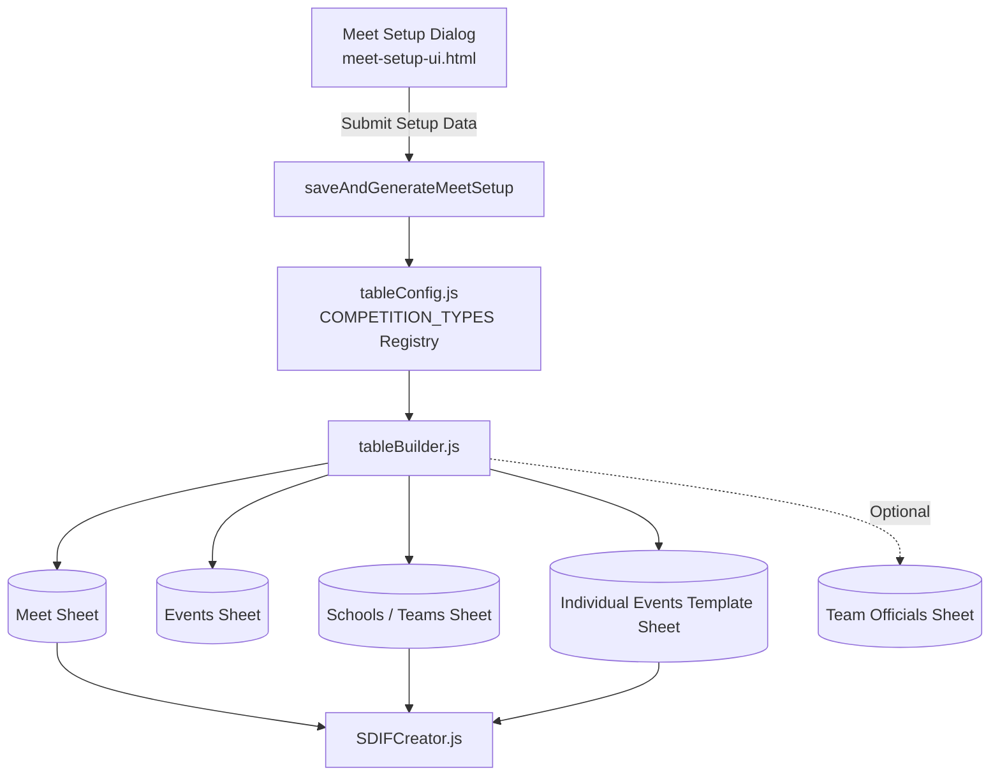

# Requirements

### Overview & Goals
This change introduces a new **Meet Setup** modal dialog screen that **replaces** the legacy "Create Core Tables" dialog (`core-tables-ui.html`). The Meet Setup screen serves as the single guided initialization step for any swim meet.

Rather than assuming all meets are school-based with fixed school years and requiring manual dropdown/placement overrides, Meet Setup allows the organizer to select the **Type of Competition** (`School`, `College`, `Age Group`, `Open`, `Masters`) along with vital meet parameters. Based on the selected competition type, Meet Setup automatically initializes the appropriate sheets (`Meet`, `Events`, `Schools` or `Teams`, `Individual Events Template`, and optionally `Team Officials`) with preconfigured defaults, customized schemas, and dynamic column layouts.

### Scope
- **In Scope**:
  - Replace `core-tables-ui.html` with a new `meet-setup-ui.html` dialog.
  - Collect vital meet metadata: Meet Name, Start Date, End Date, Course (`S` / `L`), Venue (Pool Name), City, and Region.
  - Support 5 distinct competition types: `School`, `College`, `Age Group`, `Open`, `Masters`.
  - Capture **Age-up Date** (`Start Date`, `1st January`, `31st December`) when competition type is `College`, `Age Group` or `Masters`.
  - Dynamic table schemas & defaults:
    - `School`: Defaults school years to `Y5, Y6, Y7, Y8`. "Individual Template" includes the `School Year` column (swimmer DOB becomes mocked to correspond to the correct school year - out of scope now). Sheet named `Schools`.
    - `College`: Defaults school years to `Junior, Intermediate, Senior`. "Individual Template" includes `School Year` column. Sheet named `Schools`. Requires Age-up Date. (swimmer DOB becomes mocked to correspond to the correct school year - out of scope now).
    - `Age Group`: No `School Year` column rendered in "Individual Template" (swimmer DOB collected/validated). Sheet named `Teams`. Requires Age-up Date.
    - `Open`: No `School Year` column rendered in "Individual Template". Sheet named `Teams`. Individual Template requires Date of Birth.
    - `Masters`: No `School Year` column rendered in "Individual Template". Sheet named `Teams`. Requires Age-up Date and Date of Birth.
  - Remove manual gender input `Female` and `Male` 
  - Remove table placement override inputs (Override Sheet Name, Start Cell); each core table is created on its own standard sheet.
  - Creation options: Automatically generate and populate `Meet Details`, `Events`, `Schools`/`Teams`, and `Individual Events Template`. Provide an optional checkbox for creating `Team Officials`.
  - Update Add-on Menu item (from "Create Core Tables" to "Meet Setup") and Sidebar STEP 1 launcher.
  - Update `SDIFCreator.js` to read dynamic competition types, age-up dates, and meet codes.
- **Out of Scope**:
  - Online live entry portals or external API integrations.
  - Underlying SDIF v3 specification byte formats.
  - Final calculation algorithm for mock DOBs (will be implemented in a subsequent phase).

### User Stories
- **As a school meet organizer**, I want to choose "School" in Meet Setup so that `Y5`–`Y8` school years and the `Schools` sheet are automatically configured. A `School Year` column appears in the Individual entry template, as drop downs. 
- **As a secondary/high school organizer**, I want to choose "College" so that `Junior`, `Intermediate`, and `Senior` levels are automatically set up as drop-downs in Individual Events Template.
- **As a swim club administrator**, I want to choose "Age Group" and select an Age-up Date so that my entry template collects birth dates and generates a `Teams` sheet. My Individual Events Template is without redundant school year column. School column is now called `Team`.
- **As a masters meet organizer**, I want to choose "Masters" with appropriate age-up rules so that adult age brackets and master meet codes are applied. My Individual Events Template is without redundant school year column. School column is now called `Team`.
- **As a meet administrator**, I want to generate all foundational sheets with one click from Meet Setup, optionally including a Team Officials sheet, without dealing with manual cell placement coordinates.

### Functional Requirements
- **FR-1**: The system shall provide a "Meet Setup" dialog replacing the old "Create Core Tables" dialog across the Add-on menu (`onOpen`) and Sidebar (`STEP 1`).
- **FR-2**: The dialog shall collect:
  - **Meet Name** (required text)
  - **Start Date** & **End Date** (required date pickers)
  - **Course** (Short Course `S` / 25m or Long Course `L` / 50m)
  - **Venue / Pool** (required text)
  - **City** (required text)
  - **Region** (dropdown selection from standard regional codes, e.g., `BP`, `AK`, `CB`, etc.)
  - **Type of Competition** (single select: `School`, `College`, `Age Group`, `Open`, `Masters`)
  - **Age-up Date** (dropdown: `Start Date`, `1st January`, `31st December` — visible/required ONLY when `College`, `Age Group` or `Masters` is selected)
  - **Include Team Officials Sheet** (checkbox, defaults to unchecked/checked as preferred)
- **FR-3**: Gender defaults shall be fixed to `Female, Male` across all competition types without requiring user input. This is already solved as defaults in `tableConfig.js`
- **FR-4**: Sheet placement overrides (Sheet Name, Start Cell) shall be removed; all tables are created on dedicated clean sheets.
- **FR-5**: Sheet naming and schema rules:
  - Organization table sheet shall be named `Schools` for `School` and `College` meets, and `Teams` for `Age Group`, `Open`, and `Masters` meets.
  - `Individual Events Template` table schema:
    - For `School` and `College`: includes `School Year` column with validation dropdown matching the competition type's year list; DOB column is hidden.
    - For `Age Group`, `Open`, `Masters`: excludes `School Year` column. School column is called `Team`; DOB column is mandatory and validated.
- **FR-6**: Dialog submission (`saveAndGenerateMeetSetup`) shall:
  1. Create or overwrite the `Meet` sheet and populate `Meet Details` table with dialog inputs.
  2. Create the `Events` sheet populated with default event definitions for the selected competition type.
  3. Create the `Schools` (or `Teams`) sheet with default columns and named ranges (`SchoolsList` / `TeamsList`).
  4. Create the `Individual Events Template` sheet customized for the competition type.
  5. If checked, create the `Team Officials` sheet.
- **FR-7**: `SDIFCreator.js` and `EntryDataProcessor.js` shall dynamically adapt to `Meet` table values (Competition Type, Age-up Date, and `Schools`/`Teams` table references).

### Non-Functional Requirements
- **Usability**: Clean, modern dialog UI adhering to `shared-dialog-styles.html` with reactive form visibility (showing/hiding Age-up Date depending on Competition Type).
- **Simplicity**: Zero manual placement configuration; one-click generation of the complete meet structure.
- **Data Integrity**: Validate required fields client-side before triggering Apps Script execution.
- **Validation rules:** codified in tableConfig.js

# Technical Design

### Current Implementation
- `core-tables-ui.html` provides overrides for individual tables, comma-separated inputs for School Years and Genders, and Placement overrides (`sheetName`, `startCell`).
- `tableConfig.js` has a static `YEARS` constant (`['Y5', 'Y6', 'Y7', 'Y8', 'Y9', 'Junior', 'Intermediate','Senior']`) and hardcodes school-specific labels. It also has basic structure of each table with defined validation rules, default values. It also provides getter functions.
- `tableBuilder.js` defines `createTablesFromDialog` which creates tables individually based on selected checkboxes and optional placement overrides.
- `ui.js` exposes "Create Core Tables" in the Add-on menu and Admin Sidebar Card.

### Key Decisions
- **Decision 1: Full Replacement of `core-tables-ui.html` with `meet-setup-ui.html`**
  - *Rationale*: Eliminates fragmented setup steps. Instead of asking users to select individual raw tables and specify start cells, Meet Setup collects high-level meet parameters and generates the entire workbook structure consistently in one pass.
- **Decision 2: Competition Types Registry in `tableConfig.js` (`COMPETITION_TYPES`)**
  - *Rationale*: Encapsulates competition presets (`School`, `College`, `Age Group`, `Open`, `Masters`), including their school years, organization sheet name (`Schools` vs `Teams`), SDIF meet type codes, default event lists, and template column layouts.
- **Decision 3: Dedicated Sheet Placement with No Manual Coordinates**
  - *Rationale*: Avoids layout corruption and overlapping tables. Each generated table resides on its dedicated sheet (`Meet`, `Events`, `Schools`/`Teams`, `Individual Events Template`, `Team Officials`).
- **Decision 4: Dynamic Template Schema Generation**
  - *Rationale*: `IndividualEventsTemplate` columns are dynamically assembled depending on whether the competition type utilizes `School Year` (School/College) or DOB (Age Group/Open/Masters).

### Architecture Diagram


### Data Models / Contracts

#### Competition Types Registry (`tableConfig.js`)
```javascript
const COMPETITION_TYPES = {
  SCHOOL: {
    id: 'school',
    name: 'School',
    orgSheetName: 'Schools',
    orgLabel: 'School',
    sdifCode: '7',
    hasSchoolYear: true,
    hasAgeUpDate: false,
    schoolYears: ['Y5', 'Y6', 'Y7', 'Y8'],
    defaultEvents: [
      { distance: '25m', discipline: 'Freestyle' },
      { distance: '25m', discipline: 'Backstroke' },
      { distance: '25m', discipline: 'Breaststroke' },
      { distance: '25m', discipline: 'Butterfly' },
      { distance: '50m', discipline: 'Freestyle' },
      { distance: '50m', discipline: 'Backstroke' },
      { distance: '50m', discipline: 'Breaststroke' },
      { distance: '50m', discipline: 'Breaststroke' },
      { distance: '100m', discipline: 'Freestyle' },
      { distance: '100m', discipline: 'Backstroke' },
      { distance: '100m', discipline: 'Breaststroke' },
      { distance: '100m', discipline: 'Individual Medley' }
    ]
  },
  COLLEGE: {
    id: 'college',
    name: 'College',
    orgSheetName: 'Schools',
    orgLabel: 'School',
    sdifCode: '7',
    hasSchoolYear: true,
    hasAgeUpDate: false,
    schoolYears: ['Y9', 'Junior', 'Intermediate', 'Senior'],
    defaultEvents: [
      { distance: '50m', discipline: 'Freestyle' },
      { distance: '50m', discipline: 'Backstroke' },
      { distance: '50m', discipline: 'Breaststroke' },
      { distance: '50m', discipline: 'Butterfly' },
      { distance: '100m', discipline: 'Freestyle' },
      { distance: '100m', discipline: 'Backstroke' },
      { distance: '100m', discipline: 'Breaststroke' },
      { distance: '100m', discipline: 'Individual Medley' },
      { distance: '200m', discipline: 'Freestyle' },
      { distance: '200m', discipline: 'Individual Medley' }
    ]
  },
  AGE_GROUP: {
    id: 'age_group',
    name: 'Age Group',
    orgSheetName: 'Teams',
    orgLabel: 'Team',
    sdifCode: '1',
    hasSchoolYear: false,
    hasAgeUpDate: true,
    defaultEvents: [
      { distance: '50m', discipline: 'Freestyle' },
      { distance: '50m', discipline: 'Backstroke' },
      { distance: '50m', discipline: 'Breaststroke' },
      { distance: '50m', discipline: 'Butterfly' },
      { distance: '100m', discipline: 'Freestyle' },
      { distance: '100m', discipline: 'Backstroke' },
      { distance: '100m', discipline: 'Breaststroke' },
      { distance: '100m', discipline: 'Butterfly' },
      { distance: '200m', discipline: 'Freestyle' },
      { distance: '200m', discipline: 'Individual Medley' }
    ]
  },
  OPEN: {
    id: 'open',
    name: 'Open',
    orgSheetName: 'Teams',
    orgLabel: 'Team',
    sdifCode: '0',
    hasSchoolYear: false,
    hasAgeUpDate: false,
    defaultEvents: [
      { distance: '50m', discipline: 'Freestyle' },
      { distance: '50m', discipline: 'Backstroke' },
      { distance: '50m', discipline: 'Breaststroke' },
      { distance: '50m', discipline: 'Butterfly' },
      { distance: '100m', discipline: 'Freestyle' }
    ]
  },
  MASTERS: {
    id: 'masters',
    name: 'Masters',
    orgSheetName: 'Teams',
    orgLabel: 'Club',
    sdifCode: '8',
    hasSchoolYear: false,
    hasAgeUpDate: true,
    defaultEvents: [
  { distance: "50m", discipline: "Freestyle" },
  { distance: "100m", discipline: "Backstroke" },
  { distance: "50m", discipline: "Butterfly" },
  { distance: "100m", discipline: "Freestyle" },
  { distance: "50m", discipline: "Breaststroke" },
  { distance: "200m", discipline: "Freestyle" },
  { distance: "100m", discipline: "Breaststroke" },
  { distance: "25m", discipline: "Butterfly" },
  { distance: "100m", discipline: "Individual Medley" },
  { distance: "50m", discipline: "Backstroke" },
  { distance: "25m", discipline: "Freestyle" },
  { distance: "400m", discipline: "Freestyle" },
  { distance: "800m", discipline: "Freestyle" },
  { distance: "1500m", discipline: "Freestyle" },
]
  }
};
```

#### Meet Setup Payload Interface
```javascript
/**
 * @typedef {Object} MeetSetupData
 * @property {string} meetName
 * @property {string} startDate       //  DD/MM/YYYY
 * @property {string} endDate         // DD/MM/YYYY
 * @property {string} course          // 'S' | 'L'
 * @property {string} venue           // Pool name
 * @property {string} city
 * @property {string} region          // e.g. 'BP', 'AK', 'CB'
 * @property {string} competitionType // 'school' | 'college' | 'age_group' | 'open' | 'masters'
 * @property {string} [ageUpDate]     // 'Start Date' | '1st January' | '31st December' (for age_group, masters)
 * @property {boolean} includeOfficials // true | false
 */
```

#### Updated `Meet` Table Schema
Headers: ` ['Meet Name', 'Competition Type', 'Start Date', 'End Date', 'Age-up Date', 'Course', 'Contact Name', 'Contact Phone', 'Venue', 'Venue Address1', 'City', 'Region', 'Postcode', 'Country']`

### File Structure
- `meet-setup-ui.html`: **NEW** dialog interface replacing `core-tables-ui.html`. Includes form fields, dynamic age-up date visibility, and validation.
- `core-tables-ui.html`: **DEPRECATED / REMOVED** or redirected to `meet-setup-ui.html`.
- `tableConfig.js`: **MODIFIED** with `COMPETITION_TYPES` registry, updated `Meet` schema, dynamic `IndividualEventsTemplate` column resolver, and `Schools`/`Teams` definitions.
- `tableBuilder.js`: **MODIFIED** to implement `showMeetSetupDialog()` and `saveAndGenerateMeetSetup(formData)`.
- `ui.js`: **MODIFIED** to replace "Create Core Tables" with "Meet Setup" in menus and sidebar STEP 1 action.
- `SDIFCreator.js`: **MODIFIED** to read competition type, age-up date, and support dynamic `Schools` vs `Teams` table resolution.

### Risks
- **Risk**: Existing spreadsheets created with the old core tables structure may lack new headers.
  - *Mitigation*: Maintain backward compatibility fallbacks in `SDIFCreator.js` (defaulting to `School` meet when `Competition Type` is not found).
- **Risk**: Existing macros or triggers calling `showCreateTablesDialog`.
  - *Mitigation*: Retain `showCreateTablesDialog` as an alias redirecting to `showMeetSetupDialog()`.

# Testing

### Validation Approach
Verification will be performed through scripted unit/integration tests in `tests.js` and manual UI dialog flow validations in Google Sheets.

### Key Scenarios
- **Scenario 1: School Meet Generation**
  - Open Meet Setup, enter meet info, select `School`, keep officials unchecked, and submit.
  - Verify `Meet` sheet is created with `Competition Type = School`.
  - Verify `Schools` sheet is created with `SchoolsList` named range.
  - Verify `Events` sheet is populated with 25m/50m events.
  - Verify `Individual Events Template` contains the `School Year` column with `Y5, Y6, Y7, Y8` dropdown validation.
  - Verify `Team Officials` sheet is NOT created.
- **Scenario 2: College Meet Generation**
  - Open Meet Setup, select `College`, check officials, and submit.
  - Verify `Schools` sheet is created.
  - Verify `Individual Events Template` contains `School Year` with `Y9, Junior, Intermediate, Senior` dropdown validation.
  - Verify `Team Officials` sheet IS created.
- **Scenario 3: Age Group Meet Generation**
  - Open Meet Setup, select `Age Group`.
  - Verify Age-up Date field appears; select `1st January`.
  - Submit and verify `Teams` sheet (not `Schools`) is created.
  - Verify `Individual Events Template` has NO `School Year` column, but contains validated `Date of Birth`.
  - Verify `Meet` sheet records `Age-up Date = Start Date` (of meet).
- **Scenario 4: Open & Masters Meet Generation**
  - Test `Open` meet: verify `Teams` sheet created, no `School Year` column, Age-up Date not required.
  - Test `Masters` meet: verify `Teams` sheet created, Age-up Date field enabled, Masters events populated, no `School Year` column.
- **Scenario 5: SDIF Export Integration**
  - Verify SDIF export generates valid B-records and C-records referencing the correct meet details, competition codes (`7` for School/College, `1` for Age Group, `8` for Masters), and team lookups (`Schools` or `Teams`).

### Edge Cases
- **Missing Required Form Fields**: Submitting without Meet Name, Dates, Venue, City, or Course produces instant client-side validation errors and halts execution.
- **Conditional Visibility Toggle**: Switching from `Age Group` to `School` hides the Age-up Date input and clears its required constraint.
- **Sheet Overwrite / Rebuild**: Running Meet Setup on a sheet that already contains `Meet` or `Events` prompts or cleanly rebuilds the structure without orphaned named ranges.

# Delivery Steps

### ✓ Step 1: Implement Competition Types Registry and Table Configuration Presets
The configuration layer provides preset rules for School, College, Age Group, Open, and Masters meets.

- Add `COMPETITION_TYPES` registry to `tableConfig.js` defining presets, school years, organization sheet naming (`Schools` vs `Teams`), SDIF codes, and default event lists.
- Update `getTableConfig(overrides)` to dynamically construct table column schemas, specifically toggling `School Year` vs DOB in `IndividualEventsTemplate`.
- Update `Meet` table definition in `tableConfig.js` to include `Competition Type` and `Age-up Date`.
- Fix gender defaults to `Female, Male` and eliminate placement options.

### ✓ Step 2: Create Meet Setup Modal Dialog UI
A clean, responsive modal dialog replaces the legacy core tables UI.

- Create `meet-setup-ui.html` matching `shared-dialog-styles.html`.
- Add inputs for Meet Name, Start/End Dates, Course (`S`/`L`), Venue, City, Region dropdown, Competition Type selector, Age-up Date selector, and Team Officials checkbox.
- Implement reactive client-side script to show/hide the Age-up Date field based on selected Competition Type (`Age Group` or `Masters`).
- Add client-side validation to ensure mandatory fields are filled before submitting.

### ✓ Step 3: Implement Server-Side Meet Setup & Multi-Sheet Generation Pipeline
The server-side builder creates and populates all required sheets in one unified operation.

- Implement `showMeetSetupDialog()` in `tableBuilder.js` (and keep `showCreateTablesDialog` as alias).
- Implement `saveAndGenerateMeetSetup(formData)` in `tableBuilder.js`.
- Automatically generate and populate `Meet`, `Events`, `Schools` or `Teams`, and `Individual Events Template` sheets on dedicated tabs.
- Conditionally create `Team Officials` sheet if requested by user.

### ✓ Step 4: Integrate Meet Setup with Add-on Menus, Admin Sidebar, and Export Pipelines
The UI navigation and export generators seamlessly connect with the new Meet Setup workflow.

- Update `ui.js` menu items to replace "Create Core Tables" with "Meet Setup".
- Update Sidebar STEP 1 card header, description, and button action to launch Meet Setup.
- Update `SDIFCreator.js` and `EntryDataProcessor.js` to read dynamic competition types, age-up dates, and resolve `Schools` vs `Teams` lookup tables.

### ✓ Step 5: Add Test Verification and End-to-End Validation
Automated test routines and diagnostics verify correct configuration and sheet generation for all 5 competition types.

- Add test routines in `tests.js` verifying schema generation for School, College, Age Group, Open, and Masters presets.
- Verify named range registrations (`SchoolsList` / `TeamsList`, `EventsList`) and data validation rules under each preset.
- Validate end-to-end SDIF record generation across all competition types.