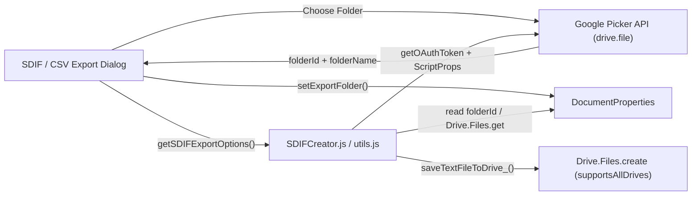

# Requirements

### Overview & Goals
Migrate **Swim Entries Manager** off the restricted `https://www.googleapis.com/auth/drive` OAuth scope to `https://www.googleapis.com/auth/drive.file` paired with the **Google Picker API**. Users will be able to select and persist a target Google Drive folder (including Shared Drives) for `.sd3`, `.csv`, and `_ExceptionReport.txt` exports without triggering Google's restricted-scope security verification.

### Scope
- **In Scope:**
  - Removing `https://www.googleapis.com/auth/drive` from `appsscript.json` and removing `DriveApp.getFileById` / `DriveApp.getFolderById` calls in `utils.js`.
  - Adding per-spreadsheet export folder persistence (`PropertiesService.getDocumentProperties()`) and Picker configuration (`PropertiesService.getScriptProperties()`) in `utils.js`.
  - Adding a shared Google Picker folder-selection UI (`shared-drive-picker.html`) integrated into both `SDIFCreator_Dialog.html` and `export-csv-ui.html`.
  - Updating `SDIFCreator.js` (`getSDIFExportOptions`, `generate`) and `exportToCSV.js` (`processSheetToCSV`) to surface and use the persisted/resolved folder.
  - Updating `tests.js`, `docs/SWIM_ENTRIES_MANAGER_SPEC.md`, `docs/USER_GUIDE.md`, and `README.md`.
- **Out of Scope:**
  - Modifying Google Form creation/sync (`formBuilder.js`) or SDIF/CSV data formatting.
  - Adding a custom UI for entering the Google Cloud Picker API key (configured once in Apps Script Script Properties).

### Functional Requirements
- **FR-1 (`drive.file` Scope Only):** `appsscript.json` shall declare `https://www.googleapis.com/auth/drive.file` and omit `https://www.googleapis.com/auth/drive` and `drive.readonly`.
- **FR-2 (Google Picker Folder Selection):** Both the SDIF Export dialog and CSV Export dialog shall show the active export destination and provide a **Choose Folder...** button that opens Google Picker (`Folders` view, supporting My Drive and Shared Drives). Selecting a folder grants `drive.file` write access to that folder ID.
- **FR-3 (Per-Spreadsheet Persistence & Reset):** The selected `folderId` and `folderName` shall be stored in `PropertiesService.getDocumentProperties()` so `.sd3`, `.csv`, and `_ExceptionReport.txt` exports share the chosen folder across sessions. Users shall also be able to clear the selection to revert to automatic detection / My Drive root.
- **FR-4 (Automatic Fallback):** When no Picker folder is stored, `getSpreadsheetParentFolderId_()` shall attempt `Drive.Files.get(spreadsheetId, { fields: 'parents', supportsAllDrives: true })` (which succeeds under `drive.file` for spreadsheets created by or opened with the add-on) and silently fall back to My Drive root (`null`) when inaccessible.
- **FR-5 (Graceful Unconfigured Picker State):** If `GOOGLE_PICKER_API_KEY` is not configured in `PropertiesService.getScriptProperties()`, exports shall continue working via `drive.file` lookup or My Drive root, and the dialog shall display a non-blocking setup hint.

# Technical Design

### Current Implementation
- `appsscript.json` requests `https://www.googleapis.com/auth/drive` (a restricted scope).
- `utils.js` implements `getSpreadsheetParentFolderId_()` using `Drive.Files.get` + `DriveApp.getFileById`, and `saveTextFileToDrive_()` using `Drive.Files.create` + `DriveApp.getFolderById` + `DriveApp.createFile`. Both `DriveApp.getFileById` and `DriveApp.getFolderById` fail under `drive.file`.
- `SDIFCreator.js` (`getSDIFExportOptions()`, `SDIFCreator.generate()`, `processSheetToSd3()`) and `exportToCSV.js` (`processSheetToCSV()`) resolve the target folder via `getSpreadsheetParentFolderId_()`.
- `SDIFCreator_Dialog.html` and `export-csv-ui.html` both include `shared-dialog-styles.html` and call `getSDIFExportOptions()` on load.

### Key Decisions
1. **Store Picker Credentials in `ScriptProperties`:** Read `GOOGLE_PICKER_API_KEY` and `GOOGLE_CLOUD_PROJECT_NUMBER` from `PropertiesService.getScriptProperties()` rather than hardcoding keys in source control.
2. **Persist Selected Folder in `DocumentProperties`:** Store `SEM_EXPORT_FOLDER_ID` and `SEM_EXPORT_FOLDER_NAME` per spreadsheet (matching `formBuilder.js`), shared by both SDIF and CSV exports.
3. **Shared HTML Partial (`shared-drive-picker.html`):** Extract the Picker loader (`https://apis.google.com/js/api.js`, `gapi.load('picker')`, `PickerBuilder`) and folder-bar markup into a reusable partial included via `HtmlService.createHtmlOutputFromFile('shared-drive-picker').getContent()` in both export dialogs.

### Architecture Diagram

### Data Models / Contracts
In `utils.js`:
- `EXPORT_FOLDER_PROP_KEYS`:
  - `FOLDER_ID: 'SEM_EXPORT_FOLDER_ID'`
  - `FOLDER_NAME: 'SEM_EXPORT_FOLDER_NAME'`
  - `PICKER_API_KEY: 'GOOGLE_PICKER_API_KEY'`
  - `CLOUD_PROJECT_NUMBER: 'GOOGLE_CLOUD_PROJECT_NUMBER'`
- `getExportFolderStatus(spreadsheetId)` → `{ folderId: string|null, folderName: string, source: 'picker'|'auto'|'root', pickerConfigured: boolean }`
- `getDrivePickerConfig()` → `{ oauthToken: string, apiKey: string, projectNumber: string }`
- `setExportFolder(folderId, folderName)` → `{ folderId: string, folderName: string, source: 'picker' }`
- `clearExportFolder()` → `getExportFolderStatus(ss.getId())`
- `getSpreadsheetParentFolderId_(spreadsheetId)`: checks `DocumentProperties` (`SEM_EXPORT_FOLDER_ID`) first, then `Drive.Files.get(spreadsheetId, { fields: 'parents', supportsAllDrives: true })`, returning `null` if unavailable.
- `saveTextFileToDrive_(content, mimeType, fileName, folderId)`: uses `Drive.Files.create` with `parents: [folderId]` and `{ supportsAllDrives: true }`, falling back directly to My Drive root (`Drive.Files.create` without `parents`, then `DriveApp.createFile`) without calling `DriveApp.getFolderById`.

### File Structure
- **Modified:** `appsscript.json`, `utils.js`, `SDIFCreator.js`, `exportToCSV.js`, `SDIFCreator_Dialog.html`, `export-csv-ui.html`, `tests.js`, `docs/SWIM_ENTRIES_MANAGER_SPEC.md`, `docs/USER_GUIDE.md`, `README.md`
- **Added:** `shared-drive-picker.html`

### Risks
- **Missing GCP Setup:** Google Picker requires `GOOGLE_PICKER_API_KEY` (with Google Picker API enabled in GCP) and `GOOGLE_CLOUD_PROJECT_NUMBER` (`setAppId`) in Script Properties so `drive.file` grants bind to the OAuth client. Mitigation: document the one-time Script Properties setup in `docs/SWIM_ENTRIES_MANAGER_SPEC.md` and degrade gracefully in the UI when unconfigured.

# Testing

### Validation Approach
1. **Automated Node.js Diagnostic Suite (`tests.js`):**
   - Assert `appsscript.json` includes `drive.file` and excludes `https://www.googleapis.com/auth/drive` and `drive.readonly`.
   - Assert `getSpreadsheetParentFolderId_()` returns the `DocumentProperties` folder ID when set, falls back to `Drive.Files.get` when unset, returns `null` when `Drive.Files.get` throws, and never calls `DriveApp.getFileById`.
   - Assert `setExportFolder()`, `clearExportFolder()`, `getExportFolderStatus()`, and `getDrivePickerConfig()` with mocked `PropertiesService` and `ScriptApp`.
   - Assert `saveTextFileToDrive_()` never calls `DriveApp.getFolderById` and falls back to My Drive root when writing to `folderId` fails.
2. **HTML / Template Sanity Check:**
   - Verify `shared-drive-picker.html`, `SDIFCreator_Dialog.html`, and `export-csv-ui.html` render cleanly and contain no syntax errors.

# Delivery Steps

### ✓ Step 1: Migrate Drive OAuth scope and server-side folder persistence
`appsscript.json` uses `drive.file` only, and `utils.js` supports Picker-selected folder persistence and `drive.file`-safe Drive operations.

- Remove `https://www.googleapis.com/auth/drive` from `oauthScopes` in `appsscript.json`.
- Remove `DriveApp.getFileById` from `getSpreadsheetParentFolderId_()` and `DriveApp.getFolderById` from `saveTextFileToDrive_()` in `utils.js`.
- Add `EXPORT_FOLDER_PROP_KEYS`, `getExportFolderStatus()`, `getDrivePickerConfig()`, `setExportFolder()`, and `clearExportFolder()` in `utils.js`, and update `getSpreadsheetParentFolderId_()` to prioritize `SEM_EXPORT_FOLDER_ID` from `DocumentProperties`.

### ✓ Step 2: Integrate export folder status into SDIF and CSV exporters
Both `SDIFCreator.js` and `exportToCSV.js` resolve and expose the export folder cleanly under `drive.file`.

- Update `getSDIFExportOptions()` in `SDIFCreator.js` to return `exportFolder: getExportFolderStatus(ss.getId())`.
- Verify `SDIFCreator.generate()`, `processSheetToSd3()`, and `processSheetToCSV()` (`exportToCSV.js`) use `getSpreadsheetParentFolderId_()` and `saveTextFileToDrive_()` without restricted-scope fallbacks.

### ✓ Step 3: Add shared Google Picker UI to SDIF and CSV export dialogs
Users can view, pick, and reset the export Drive folder directly inside both export dialogs.

- Create `shared-drive-picker.html` with the folder-status bar, **Choose Folder...** / **Reset** controls, and `gapi.load('picker')` integration (`google.picker.ViewId.FOLDERS`, `setSelectFolderEnabled(true)`, `setEnableDrives(true)`, `setAppId`).
- Include `shared-drive-picker.html` in `SDIFCreator_Dialog.html` and `export-csv-ui.html` and wire it to `options.exportFolder` on dialog initialization.

### ✓ Step 4: Update diagnostic tests and documentation
The Node.js diagnostic suite verifies `drive.file` compliance and Picker persistence, and docs reflect the new scope and setup.

- Update `testExportFolderResolutionAndFallback()` in `tests.js` to test `appsscript.json` scopes, `DocumentProperties` folder persistence, `getExportFolderStatus()` / `getDrivePickerConfig()`, and `drive.file`-only `DriveApp` assertions; run `runAllDiagnosticTests()`.
- Update `docs/SWIM_ENTRIES_MANAGER_SPEC.md`, `docs/USER_GUIDE.md`, and `README.md` to remove `drive` scope references and document the `ScriptProperties` setup for Google Picker (`GOOGLE_PICKER_API_KEY`, `GOOGLE_CLOUD_PROJECT_NUMBER`).