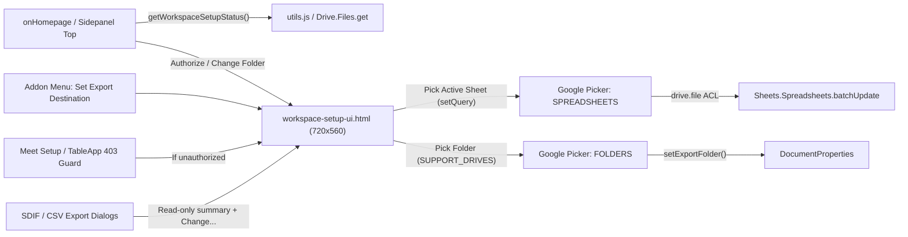

# Requirements

### Overview & Goals
Move Google Picker out of the SDIF and CSV export dialogs into a dedicated **Workspace & Export Setup** workflow anchored at the top of the **Swim Entries Manager** sidepanel (above **Meet Setup**) and in the Add-on menu. This enables two capabilities under non-sensitive OAuth scopes (`spreadsheets.currentonly` + `drive.file`):
1. **One-Click Spreadsheet Authorization (Workaround 1):** Grant `drive.file` access to the active spreadsheet via Google Picker so `Sheets.Spreadsheets.batchUpdate` (`TableApp`) works without requiring the sensitive `https://www.googleapis.com/auth/spreadsheets` scope.
2. **Reliable Export Destination Selection:** Choose a Google Drive / Shared Drive folder for `.sd3`, `.csv`, and `_ExceptionReport.txt` exports in a dedicated `720×560` modal dialog instead of resizing the `500×520` export dialogs.

### Scope
- **In Scope:**
  - Removing the sensitive `https://www.googleapis.com/auth/spreadsheets` scope from `appsscript.json` (retaining `spreadsheets.currentonly` and `drive.file`).
  - Adding `isSpreadsheetAuthorized_(spreadsheetId)` and `getWorkspaceSetupStatus()` in `utils.js` (checking `Drive.Files.get` under `drive.file`).
  - Adding a top-level **Workspace & Export Setup** status section at the top of `buildAdminSidebarCard()` in `ui.js` (above **Meet Setup**), plus menu items in `onOpen(e)` (`Workspace & Export Setup` at the top and `Set Export Destination` in the Export section).
  - Adding a 403 / unauthorized guard in `ui.js` (`showMeetSetupDialog()`, `showCreateSheetsDialog()`, `showCreateRelayTablesDialog()`) and `TableApp_Local.js` (`batchUpdate_()`) to prompt the Picker authorization modal if a user tries to create/update tables before authorizing the spreadsheet.
  - Creating `workspace-setup-ui.html` (dedicated `720×560` modal with Step 1: **Authorize This Spreadsheet** pre-filtered by `ss.getName()` and Step 2: **Export Destination Folder**).
  - Simplifying `shared-drive-picker.html`, `SDIFCreator_Dialog.html`, and `export-csv-ui.html` to show a read-only Destination Folder summary with a **Change...** button that opens `showWorkspaceSetupDialog()`.
  - Updating `tests.js`, `docs/SWIM_ENTRIES_MANAGER_SPEC.md`, and `docs/USER_GUIDE.md`.
- **Out of Scope:**
  - Changing SDIF/CSV data formatting or Google Form builder logic (`formBuilder.js`).
  - Auto-opening a modal dialog directly inside `onHomepage(e)` (blocked by Google Workspace Add-on `CardService` runtime rules; handled instead via the prominent top-of-sidepanel status card and the 403 guard).

### Functional Requirements
- **FR-1 (Non-Sensitive OAuth Scopes):** `appsscript.json` shall remove `https://www.googleapis.com/auth/spreadsheets` and rely on `https://www.googleapis.com/auth/spreadsheets.currentonly` + `https://www.googleapis.com/auth/drive.file`.
- **FR-2 (Top-of-Sidepanel Status & Launch UX):** `buildAdminSidebarCard()` in `ui.js` shall render **Workspace & Export Setup** as the first section above **Meet Setup**, showing either an amber **Action Required: Authorize Spreadsheet** prompt (when `Drive.Files.get` fails under `drive.file`) or a green **Workspace Ready** summary with the active export folder and a **Change Export Folder** button.
- **FR-3 (Add-on Menu Access):** `onOpen(e)` in `ui.js` shall expose **Workspace & Export Setup** above **Meet Setup** and **Set Export Destination** above **Export for Meet Manager**, both opening `showWorkspaceSetupDialog()`.
- **FR-4 (403 / Unauthorized Guard):** If `isSpreadsheetAuthorized_()` is `false` when launching **Meet Setup**, **Create Sheets from Template**, or **Create Relay Tables** (or if `batchUpdate_()` in `TableApp_Local.js` throws a `403`/`404` permission error), the add-on shall automatically launch `showWorkspaceSetupDialog()` (or surface a clear one-click authorization prompt) instead of failing with a raw API error.
- **FR-5 (Dedicated `720×560` Picker Modal):** `workspace-setup-ui.html` shall open at `720×560` (no dynamic `setWidth`/`setHeight` resizing) and support:
  - **Authorize This Spreadsheet:** `DocsView(ViewId.SPREADSHEETS)` pre-filtered by `SpreadsheetApp.getActiveSpreadsheet().getName()`, validating that the picked file ID matches the active spreadsheet ID.
  - **Export Destination Folder:** `DocsView(ViewId.FOLDERS)` with `SUPPORT_DRIVES`, persisting `folderId`/`folderName` in `DocumentProperties` via `setExportFolder()`, plus **Reset** via `clearExportFolder()`.
- **FR-6 (Clean Export Dialogs):** `SDIFCreator_Dialog.html` and `export-csv-ui.html` shall no longer embed or dynamically resize the Google Picker iframe; instead, they display the current Destination Folder status and a **Change...** button that opens `showWorkspaceSetupDialog()`.

# Technical Design

### Current Implementation
- `appsscript.json` declares both `spreadsheets.currentonly` and `spreadsheets` (Sensitive scope).
- `ui.js` (`buildAdminSidebarCard()`) starts directly with `Meet Setup (STEP 1)` and has no menu item for export destination or sheet authorization.
- `shared-drive-picker.html` embeds Google Picker JS inside `SDIFCreator_Dialog.html` and `export-csv-ui.html` (`500×520`) and calls `google.script.host.setWidth(720)` / `setHeight(560)`, which renders unreliably inside nested export modals.
- `TableApp_Local.js` (`batchUpdate_()`) calls `Sheets.Spreadsheets.batchUpdate({ requests }, sid)` directly without checking `drive.file` authorization first.

### Key Decisions
1. **Top Sidepanel Section + 403 Guard instead of `onHomepage` Modal:** Google Workspace Add-ons cannot call `SpreadsheetApp.getUi().showModalDialog()` from `onHomepage(e)`. Placing **Workspace & Export Setup** at the top of `buildAdminSidebarCard()` gives immediate visibility on launch, while guarding `showMeetSetupDialog()` / `batchUpdate_()` ensures users are automatically prompted if they jump straight to table creation.
2. **Unified Dedicated `720×560` Modal (`workspace-setup-ui.html`):** Separating Sheet Authorization and Export Folder Selection into one dedicated `720×560` modal (matching `relay-ui-full.html` sizing) eliminates dynamic resizing and iframe clipping in export dialogs.
3. **Pre-filtered Spreadsheet Picker (`setQuery`):** Pre-filtering `DocsView(ViewId.SPREADSHEETS)` with `SpreadsheetApp.getActiveSpreadsheet().getName()` places the active spreadsheet at the top of the Picker list for one-click `drive.file` authorization.

### Architecture Diagram

### Data Models / Contracts
- **In `utils.js`:**
  - `isSpreadsheetAuthorized_(spreadsheetId)` → `boolean`: calls `Drive.Files.get(spreadsheetId, { fields: 'id', supportsAllDrives: true })` in `try...catch`; returns `true` if accessible under `drive.file`, `false` on `403`/`404`.
  - `getWorkspaceSetupStatus()` → `{ spreadsheetId: string, spreadsheetName: string, isAuthorized: boolean, exportFolder: { folderId, folderName, source, pickerConfigured } }`.
  - `getDrivePickerConfig()` → `{ oauthToken, apiKey, projectNumber, spreadsheetId, spreadsheetName }` (extended with active spreadsheet ID/name for pre-filtering and match validation).
- **In `ui.js`:**
  - `showWorkspaceSetupDialog()` → opens `workspace-setup-ui.html` at `720×560` with title `"Workspace & Export Setup"`.
  - `ensureSpreadsheetAuthorizedOrPrompt_()` → checks `isSpreadsheetAuthorized_()`; if `false`, opens `showWorkspaceSetupDialog()` and returns `false` so callers abort cleanly before running `batchUpdate`.
- **In `TableApp_Local.js`:**
  - `batchUpdate_(spreadsheetId, requests)` → wraps `Sheets.Spreadsheets.batchUpdate` error handling to throw a clear `SHEET_NOT_AUTHORIZED` message if status is `403`/`404` under `drive.file`.

### File Structure
- **Added:** `workspace-setup-ui.html`
- **Modified:** `appsscript.json`, `utils.js`, `ui.js`, `TableApp_Local.js`, `shared-drive-picker.html`, `SDIFCreator_Dialog.html`, `export-csv-ui.html`, `tests.js`, `docs/SWIM_ENTRIES_MANAGER_SPEC.md`, `docs/USER_GUIDE.md`

### Risks
- **User Picks Wrong Spreadsheet in Picker:** In `DocsView(ViewId.SPREADSHEETS)`, a user could click a different file with a similar name. Mitigation: pre-filter by exact `spreadsheetName`, validate `doc.id === config.spreadsheetId` in `workspace-setup-ui.html`, and show an inline retry message if they select a different file.
- **OAuth Re-consent:** Removing `spreadsheets` scope changes `appsscript.json` scopes. Mitigation: document `clasp push` + re-authorization in `docs/SWIM_ENTRIES_MANAGER_SPEC.md`.

# Testing

### Validation Approach
1. **Automated Node.js Diagnostic Suite (`tests.js`):**
   - Assert `appsscript.json` excludes `https://www.googleapis.com/auth/spreadsheets` and includes `spreadsheets.currentonly` and `drive.file`.
   - Assert `isSpreadsheetAuthorized_()` and `getWorkspaceSetupStatus()` return `true`/`false` accurately when `Drive.Files.get` succeeds or throws `403`/`404`.
   - Assert `getDrivePickerConfig()` returns `spreadsheetId` and `spreadsheetName`.
   - Assert `buildAdminSidebarCard()` renders the **Workspace & Export Setup** section above **Meet Setup** in both authorized and unauthorized states.
2. **HTML Script Syntax & Template Check:**
   - Validate inline `<script>` blocks in `workspace-setup-ui.html`, `shared-drive-picker.html`, `SDIFCreator_Dialog.html`, and `export-csv-ui.html` via `vm.Script`.

# Delivery Steps

### ✓ Step 1: Update OAuth scopes, Drive authorization helpers, and 403 guard
`appsscript.json` removes the sensitive `spreadsheets` scope, and `utils.js` + `TableApp_Local.js` expose `drive.file` authorization status and clean 403 handling.

- Remove `"https://www.googleapis.com/auth/spreadsheets"` from `oauthScopes` in `appsscript.json`.
- Add `isSpreadsheetAuthorized_()` and `getWorkspaceSetupStatus()` in `utils.js`, and extend `getDrivePickerConfig()` to include `spreadsheetId` and `spreadsheetName`.
- Update `batchUpdate_()` in `TableApp_Local.js` to catch `403`/`404` permission errors and throw an actionable authorization error.

### ✓ Step 2: Create the dedicated `720×560` Workspace & Export Setup modal
Users can authorize the active spreadsheet and choose an export destination folder in a dedicated, reliably sized Picker modal.

- Create `workspace-setup-ui.html` using `shared-dialog-styles.html` with two sections: **1. Authorize This Spreadsheet** (`DocsView(ViewId.SPREADSHEETS)` pre-filtered by `spreadsheetName`, validating `doc.id === config.spreadsheetId`) and **2. Export Destination Folder** (`DocsView(ViewId.FOLDERS)` with `SUPPORT_DRIVES`, `setExportFolder()`, and `clearExportFolder()`).
- Add `showWorkspaceSetupDialog()` and `ensureSpreadsheetAuthorizedOrPrompt_()` in `ui.js`.

### ✓ Step 3: Update sidepanel, Add-on menu, and export dialogs
The sidepanel surfaces **Workspace & Export Setup** above **Meet Setup**, the menu exposes **Set Export Destination**, and export dialogs display a clean read-only folder bar.

- Update `buildAdminSidebarCard()` in `ui.js` to render the **Workspace & Export Setup** status section above **Meet Setup** (showing authorization warning or ready state + active export folder).
- Update `onOpen(e)` in `ui.js` to add **Workspace & Export Setup** and **Set Export Destination**, and wire `ensureSpreadsheetAuthorizedOrPrompt_()` into `showMeetSetupDialog()`, `showCreateSheetsDialog()`, and `showCreateRelayTablesDialog()`.
- Simplify `shared-drive-picker.html` (removing inline Picker iframe/resizing and adding a **Change...** button calling `showWorkspaceSetupDialog()`) and verify `SDIFCreator_Dialog.html` and `export-csv-ui.html` render the read-only folder summary cleanly.

### ✓ Step 4: Update diagnostic tests and documentation
The Node.js diagnostic suite and documentation reflect the new non-sensitive scope and Workspace & Export Setup workflow.

- Update `tests.js` (`testExportFolderResolutionAndFallback()` and `ui.js` sidebar assertions) and run `runAllDiagnosticTests()` plus `vm.Script` syntax checks on all HTML files.
- Update `docs/SWIM_ENTRIES_MANAGER_SPEC.md` and `docs/USER_GUIDE.md` to document the removal of `spreadsheets` scope, the **Workspace & Export Setup** sidepanel section, **Set Export Destination** menu item, and one-click spreadsheet authorization flow.